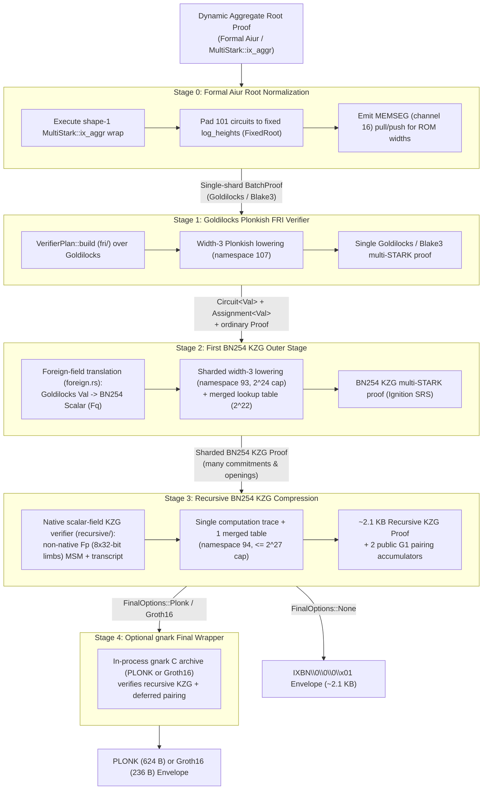

# Certified Proof Compression: Pipeline Architecture and Certification Design

This document describes the end-to-end proof compression pipeline in `ix` (Stages 0–4) following the migration of root normalization to the certified Formal Aiur runtime (`crates/aiur` and `MultiStark::ix_aggr`), together with the architectural trade-off analysis governing the Lean 4 formal certification of the compression circuits (`Ix/Cert/Compression/`).

---

## 1. End-to-End KZG Compression Pipeline (Stages 0–4)

The compression pipeline reduces a dynamic-shape Formal Aiur / `MultiStark` aggregate STARK proof over the Goldilocks field ($\mathbb{F}_p$, $p = 2^{64} - 2^{32} + 1$) with Blake3 Merkle commitments into a succinct BN254 proof (a ~2.1 KB recursive KZG proof, or an optional 584 B BN254 PLONK / 196 B BN254 Groth16 final wrapper suitable for EVM verification).



### Stage 0: Formal Aiur Root Normalization (`crates/aiur/src/trace/stark/batch.rs`, `pipeline/root/fixed.rs`)

An aggregate root proof produced by `ix prove --aggregate` or `ix aggregate` is a `BatchProof` for the certified `MultiStark::ix_aggr` program (`crates/stark-verifier`), wrapped with the 8-byte `"IXAGGR2\0"` header. Its circuit heights vary with the workload (e.g., `Nat.add_comm`, `Init`, or `Mathlib`) and it may span multiple trace shards.

To verify this root proof inside a fixed-shape downstream circuit whose verifying key is pinned in a release:

1. **Shape-1 Formal Aiur Wrap**: When compressing a dynamic root proof, `crates/ffi/src/compression.rs` runs a shape-1 `MultiStark::ix_aggr` execution (`stark_verifier::prepare` + `aiur::trace::Backend::execute`) that verifies the incoming aggregate root proof and preserves its 18 public claim elements.
2. **Fixed Trace Geometry (`FixedRoot`)**: `Backend::prove_normalized` pads all 101 circuits of the `ix_aggr` STARK system (function circuits, preprocessed lookup tables, and segmented ROM circuits) to the fixed power-of-two heights specified by `FixedRoot` (`verifying-keys/0.1/layout.json`).
3. **Segmented ROM Boundary Closure (`MEMSEG = 16`)**: In a multi-shard batch proof, the segmented memory channel (`MEMSEG = 16`) is closed across shards by the batch preamble's `memory_sizes`. Normalization collapses the execution into a single shard (`proofs.len() == 1`) with an empty message list (`messages: vec![]`) so that `FixedRoot::build` can verify it as an ordinary single-proof `multi_stark::prover::Proof`. To balance the step transitions `(0, width, i) -> (0, width, i + 1)` inside each ROM circuit, `prove_normalized` emits a pull of `[0, width, 0]` (multiplicity $-1$) and a push of `[0, width, unpadded_rows]` (multiplicity $+1$) on channel `MEMSEG` (`16`) for every ROM width (including empty ROM tables where `unpadded_rows == 0`, which emit balanced $0 \to 0$ boundary messages matching `FixedRoot::build`).
4. **Preamble Validation**: `VerifyingKey::validate_preamble` checks preamble soundness (public IO channel `Val::ZERO` claim binding, zero initial memory offsets, balanced `MEMSEG` boundary messages, and auxiliary channel sums) before the single-shard proof is handed to Stage 1.

### Stage 1: Goldilocks Plonkish FRI Verifier (`crates/proof-compression/src/fri/`, `pipeline/stage.rs`)

Stage 1 verifies the normalized 101-circuit Stage 0 root proof inside a Plonkish circuit over the same Goldilocks field (`Val`):

- **`VerifierPlan::build`**: Constructs a `multi_stark::plonkish::Circuit<Val>` encoding the complete STARK verifier for the fixed 101-circuit `FixedRoot` profile:
  - **Fiat–Shamir Transcript (`fri/transcript.rs`)**: Absorbs public claims, trace Merkle roots, stage-2 lookup commitments, quotient commitments, OOD evaluations, and FRI layer roots using the bitwise Blake3 gadget (`multi_stark::plonkish::gadgets::blake3`) and draws extension-field challenges with bounded rejection sampling (`DEFAULT_FIELD_RETRIES`).
  - **Symbolic AIR & LogUp Evaluation (`fri/algebra.rs`)**: Evaluates the compiled constraint graphs (`CircuitInputs::compile_graph`) and LogUp rational relations for all 101 circuits over the quartic/quadratic Goldilocks extension (`QuadraticValue`), folding them against the quotient chunks at the out-of-domain point $\zeta$.
  - **Merkle PCS & FRI Folding (`fri/pcs.rs`)**: Verifies Blake3 Merkle authentication paths for every queried leaf across the trace, stage-2, quotient, and FRI folding layers, and checks degree-bound interpolation down to the final polynomial.
- **Lowering & Proving**: `lower_fri` lowers the `Circuit<Val>` via `Circuit::lower_to_multi_stark_sharded` (namespace `107`, lookup group size `3`) into a compact width-3 multi-STARK over Goldilocks/Blake3. This collapses the 101 heterogeneous Aiur chips into a uniform width-3 Plonkish multi-STARK proof before crossing into the BN254 scalar field.

### Stage 2: First BN254 KZG Outer Stage (`crates/proof-compression/src/foreign.rs`, `kzg/`, `pipeline/first.rs`)

Stage 2 verifies the Stage 1 Goldilocks FRI proof inside a Plonkish circuit over the BN254 scalar field (`Scalar` / $\mathbb{F}_q$, where $q \approx 2^{254}$):

1. **Stage 1 Verifier Circuit in Goldilocks**: First, `FriConstruction::build` builds the `Circuit<Val>` that verifies the Stage 1 Goldilocks/Blake3 proof.
2. **Foreign-Field Translation (`foreign.rs`)**: `GoldilocksCircuit::new_preallocated` translates every gate, wire, lookup, and public input of `Circuit<Val>` into an equivalent `Circuit<Scalar>` over BN254 $\mathbb{F}_q$:
   - Because $p = 2^{64} - 2^{32} + 1 \ll q \approx 2^{254}$, arithmetic in $\mathbb{F}_p$ does not wrap modulo $q$ when tracking explicit quotient witnesses.
   - Each modular polynomial identity $P(x_1, \dots, x_k) \equiv 0 \pmod p$ in a Goldilocks gate is lifted to an exact integer identity in $\mathbb{F}_q$:
     $$P_{\mathbb{Z}}(x_1, \dots, x_k) = q_{\text{gate}} \cdot p \quad \text{in } \mathbb{F}_q$$
     where the signed quotient witness $q_{\text{gate}}$ is range-checked via 4-bit nibble lookup tables (`interval.rs`, `quotient.rs`) to prevent $\mathbb{F}_q$ wrap-around.
   - Canonical range checks ($0 \le x < p$) decompose 64-bit Goldilocks elements into sixteen 4-bit nibbles and enforce that the upper 32 bits are not all `0xFFFFFFFF` unless the lower 32 bits are zero.
3. **Sharded Width-3 KZG Lowering (`lower_first`)**: The translated `Circuit<Scalar>` has tens of millions of gates—exceeding the $2^{26}$ degree bound of the Aztec Ignition SRS. `lower_first` lowers the circuit with `lower_to_multi_stark_sharded(Scalar::from_u8(93), 1 << 24)` into computation shards capped at height $2^{24}$ (`FIRST_PARTITION_HEIGHT`) plus a single merged lookup table of height $2^{22}$ (`TABLE_HEIGHT`), linked by cross-shard LogUp bus arguments.
4. **BN254 KZG Proving (`kzg/`)**: Committed columns are committed using the authenticated Aztec Ignition BN254 SRS (`bn254-ignition-main-197/srs.bin`) and opened via batch KZG multipoint openings (`Shplonk` / `Bdfg`).

### Stage 3: Recursive BN254 KZG Compression (`crates/proof-compression/src/recursive/`, `pipeline/wrap.rs`)

Because Stage 2 is sharded across multiple $2^{24}$-row partitions, its proof carries dozens of BN254 $\mathbb{G}_1$ commitments and scalar evaluations. Translating a multi-shard KZG verifier directly into gnark R1CS/PLONK constraints would require hundreds of non-native BN254 $\mathbb{F}_p$ multi-scalar multiplications inside the final circuit.

Stage 3 eliminates that overhead by running one recursive BN254 KZG stage (`recursive/`):

- **Native Scalar-Field Verifier (`recursive/native_verifier.rs`)**: Written directly as a `Circuit<Scalar>` over $\mathbb{F}_q$:
  - **Scalar Algebra & Fiat–Shamir (`native_transcript.rs`)**: Because the inner Stage 2 proof is already over $\mathbb{F}_q$, all Stage 2 vanishing polynomials, LogUp bus sums, OOD quotient checks, and opening linear combinations are **native** $\mathbb{F}_q$ field operations (1 gate per operation, zero foreign-field overhead).
  - **Non-Native Base-Field Curve Arithmetic (`native_field.rs`, `native_curve.rs`, `native_msm.rs`)**: BN254 $\mathbb{G}_1$ commitment points lie over the BN254 base field $\mathbb{F}_p$ ($p_{\text{BN254}} \approx 2^{254}$). The circuit represents $\mathbb{F}_p$ elements as 8 limbs of 32 bits (`LIMBS = 8`, `LIMB_BITS = 32`) with 16-bit range tables, verifies on-curve and subgroup checks, and folds all commitment openings via windowed Pippenger/Shamir multi-scalar multiplication (`native_msm.rs`) into two final $\mathbb{G}_1$ pairing accumulator points $(P, Q)$.
  - **Deferred Public Pairing (`pairing.rs`)**: Rather than computing a bilinear pairing inside $\mathbb{F}_q$, the circuit exposes the two folded $\mathbb{G}_1$ accumulators as public outputs (`PAIRING_PUBLIC_VALUES = 32` limbs).
- **Single-Shard Output**: `lower_recursive` compiles the recursive verifier into **1 computation trace + 1 merged table trace** (under namespace `94`), producing a self-contained **~2.1 KB recursive KZG proof** (`IXBN\0\0\0\x01`). A standalone verifier checks the proof and performs one native pairing check $e(P, [1]_2) \stackrel{?}{=} e(Q, [\tau]_2)$.

### Stage 4: Optional gnark PLONK or Groth16 Final Wrapper (`pipeline/plonk.rs`, `pipeline/groth16.rs`, `tools/gnark/`)

When `--plonk` or `--groth16` (`--compress plonk` / `--compress groth16`) is selected, Stage 4 invokes the in-process Go `gnark` C archive (`libix_plonk_wrapper.a`) to verify the Stage 3 recursive KZG proof (which has only 1 computation shard and 1 merged table shard) along with its deferred pairing check in BN254 R1CS/PLONK constraints, emitting either:
- A **584 B native / 624 B Ix envelope BN254 PLONK proof** (using the same Aztec Ignition SRS), or
- A **196 B native / 236 B Ix envelope BN254 Groth16 proof** (318,490 EVM execution gas).

---

## 2. Lean Certification Architecture: Approach 1 vs. Approach 2

To formally certify the soundness of the compression pipeline in Lean 4 (`Ix/Cert/Compression/`), we must bridge the gap between the top-level statementverified by the outer KZG proof and the inner STARK / FRI security relation. Two architectural approaches were evaluated in detail.

### Overview of the Two Approaches

- **Approach 1 (Direct Low-Level Plonkish + `foreign.rs` + `OuterIR` Certification in Lean, Parameterized over `(vk, layout)`)**:
  Keep the production Rust compression pipeline as-is (`fri/` -> `foreign.rs` -> `lower_to_multi_stark_sharded` -> `recursive/`), mirror its intermediate representations (`Plonkish.Circuit`, `GoldilocksCircuit`, `MultiStarkCircuit`, `NativeVerifier`) in Lean 4 under `Ix/Cert/Compression/`, and prove a parameterized soundness theorem universally quantified over `(vk : VerifierKey) (layout : FixedRoot)`.
- **Approach 2 (Rewriting the Outer Verifiers as Formal Aiur Multi-Chip AIR Programs)**:
  Replace the `multi_stark::plonkish` frontend (`fri/`, `foreign.rs`, and `recursive/`) with high-level `.aiur` programs compiled by the certified Formal Aiur compiler (`Aiur/Compiler.lean` + `crates/aiur`) into multi-chip wide AIRs, reusing the existing Formal Aiur semantics and compiler proofs.

| Dimension | Approach 1: Direct Plonkish / `foreign.rs` / `OuterIR` Certification | Approach 2: Formal Aiur Multi-Chip AIR Outer Verifier |
| :--- | :--- | :--- |
| **Trace Geometry** | Uniform width-3 Plonkish columns (`a, b, c`) + fixed selectors (`q_l, q_r, q_o, q_m, q_c, ...`) | 60–100+ heterogeneous wide AIR chips (50–200+ columns per chip) |
| **Commitment Scheme Fit** | Optimal for **BN254 KZG** (few committed columns, long traces sharded at $2^{24}$) | Designed for **Goldilocks + Blake3 Merkle** (row-wise hashing makes wide columns nearly free, but KZG penalizes every column with a BN254 $\mathbb{G}_1$ MSM) |
| **Committed Columns in Stage 2** | ~10–15 columns per $2^{24}$ shard (~50–75 columns total across 5 shards) | ~1,500–3,000+ wide columns across 60–100 chips |
| **Aztec Ignition $2^{26}$ SRS Cliff** | Handled natively by `lower_to_multi_stark_sharded` ($2^{24}$ shards + $2^{22}$ merged lookup table) | Cannot flatten without exceeding the $2^{26}$ Ignition SRS limit; cannot use wide chips without blowing up KZG column commitments and Stage 3 MSM witness size |
| **Field Genericity** | Supports both Goldilocks ($\mathbb{F}_p$) and BN254 scalar field ($\mathbb{F}_q$) + foreign-field translation (`foreign.rs`) | Formal Aiur (`Aiur/Field.lean`, `crates/aiur`) is hardcoded to the 64-bit Goldilocks field $p = 2^{64} - 2^{32} + 1$ |
| **Maintenance When `vk` / `layout` Changes** | **Zero Lean proof updates** (soundness theorem is universally quantified over `(vk, layout)`) | Requires recompiling `.aiur` programs and re-certifying generated chip shapes whenever layout or query count changes |

---

### Deep-Dive 1: Multi-Chip High-Width AIR vs. Flat Width-3 Plonkish Lowering

Formal Aiur (`crates/aiur`) and `multi_stark::plonkish` target fundamentally different regions of the arithmetization design space:

1. **Formal Aiur Multi-Chip AIR (`crates/aiur`)**:
   - Compiles each function group into a dedicated AIR circuit where **one row corresponds to one function invocation** (or loop iteration).
   - Every local variable, auxiliary witness, selector, and lookup argument in the function body becomes a **distinct column** in that chip's trace matrix.
   - For complex programs (such as `ixvm` or `ix_aggr`), this produces **60 to 101 circuits**, with individual chips having **widths of 50 to 250+ columns** and relatively short heights ($2^4$ to $2^{20}$ rows).
2. **Flat Width-3 Plonkish Lowering (`Circuit::lower_to_multi_stark_sharded`)**:
   - Represents the computation as a flat sequence of fan-in-2 Plonkish gates ($q_L \cdot a + q_R \cdot b + q_O \cdot c + q_M \cdot a b + q_C = 0$, plus custom gates and LogUp lookups) over just **3 advice columns (`a, b, c`)**.
   - Lowering packs millions of heterogeneous gates vertically into a single narrow trace (or a small number of uniform $2^{24}$-height shards) with a fixed number of columns per shard.
   - Copy constraints (wiring between arbitrary gates) are enforced via a permutation / memory-bus argument across rows rather than by allocating new columns.

---

### Deep-Dive 2: The Column-Commitment Cost in BN254 KZG

Why is Formal Aiur's wide multi-chip layout fast in Stage 0 (Goldilocks/Blake3) yet prohibitive in Stages 2 and 3 (BN254 KZG)? The answer lies in the asymmetry between **row-wise Merkle commitments** and **column-wise KZG polynomial commitments**:

- **In Goldilocks + Blake3 FRI (Stage 0)**:
  - The prover interpolates each column via a 64-bit Goldilocks NTT, evaluates it on a coset, and commits to the entire matrix using **one Blake3 Merkle tree over the rows**.
  - Increasing a chip's width from 3 columns to 150 columns still produces **1 Merkle root per chip** (32 bytes) and 1 Merkle authentication path per FRI query.
- **In BN254 KZG (Stages 2 & 3)**:
  - Each column is committed independently as a univariate polynomial $f_j(X) \in \mathbb{F}_q[X]$ via a BN254 $\mathbb{G}_1$ Multi-Scalar Multiplication (MSM):
    $$C_j = \sum_{i=0}^{N-1} f_{j,i} \cdot [\tau^i]_1 \in \mathbb{G}_1$$
  - Consequently, **every committed column** (preprocessed, main trace, stage-2 LogUp running sums, and quotient chunks) incurs:
    1. A 254-bit prime-field IFFT/coset-FFT and a $2^k$-point BN254 $\mathbb{G}_1$ MSM during Stage 2 proving.
    2. An explicit 32-byte compressed $\mathbb{G}_1$ point $C_j$ in the Stage 2 proof and an evaluation scalar $f_j(\zeta) \in \mathbb{F}_q$ in the OOD opening packet.
    3. **Inside the Stage 3 recursive KZG verifier (`recursive/native_msm.rs`)**: Every committed column in Stage 2 adds another non-native BN254 $\mathbb{F}_p$ curve point that must be parsed, validated on-curve ($y^2 = x^3 + 3 \pmod{p_{\text{BN254}}}$ using 8×32-bit non-native limbs), absorbed into the Fiat–Shamir transcript, and folded in the in-circuit non-native Pippenger MSM.
  - Because `lower_first` and `lower_recursive` use width-3 Plonkish lowering (`merge_table_traces`), each computation shard has only 3 main witness columns, a small fixed set of preprocessed selector/wiring columns, and tuned stage-2 lookup columns (`tune_kzg_input` specifically optimizes `lookup_group_size` to minimize `width * (commitment_bytes + 64) + quotient * (commitment_bytes + 32)`).
  - By contrast, compiling the outer verifier as a 100-chip Formal Aiur program with thousands of total columns would multiply the number of $\mathbb{G}_1$ commitments by $20\times\text{–}50\times$, blowing up the Stage 3 non-native MSM circuit beyond the recursive trace height cap.

---

### Deep-Dive 3: The $2^{26}$ Aztec Ignition SRS Row Cliff

The BN254 KZG and final PLONK stages rely on the authenticated **Aztec Ignition trusted setup ceremony** (`bn254-ignition-main-197`, positions 196 and 197, matching SP1's ceremony verification).

- **Hard Ceremony Degree Limit**: The Aztec Ignition ceremony provides powers of $\tau$ up to degree $2^{26}$ ($67,108,864$ points in $\mathbb{G}_1$). No polynomial committed under the Ignition SRS—neither a trace column nor a coset quotient polynomial—can exceed degree $2^{26}$ without abandoning the Ignition ceremony.
- **Why Unsharded Flat Circuits Hit the Cliff**:
  - In Stage 2, translating the Goldilocks FRI verifier (`Circuit<Val>`) into BN254 $\mathbb{F}_q$ via `foreign.rs` expands each Goldilocks gate by roughly $6\times\text{–}10\times$ (to decompose 64-bit limbs and range-check the modular quotient $q_{\text{gate}}$ in 4-bit lookup tables).
  - The resulting `Circuit<Scalar>` contains $\sim 5 \times 10^7$ to $8 \times 10^7$ Plonkish rows—exceeding $2^{26}$ in a single trace.
- **How Width-3 Sharded Plonkish Resolves the Cliff**:
  - `Circuit::lower_to_multi_stark_sharded(Scalar::from_u8(93), 1 << 24)` automatically partitions the width-3 gate stream into uniform shards of height $2^{24}$ ($16,777,216$ rows, well below the $2^{26}$ Ignition limit with $4\times$ quotient headroom), routing cross-shard wire references through the shared LogUp bus and merging all lookup tables into a single $2^{22}$-row table trace (`merge_table_traces(1 << 22)`).
  - In Stage 3 (`recursive/`), because all Stage 2 scalar-field checks are native in $\mathbb{F}_q$ and only the folded $\mathbb{G}_1$ MSM uses non-native $\mathbb{F}_p$ limbs, the entire recursive verifier fits inside a **single shard** below $2^{26}$ rows.
  - Attempting to express Stage 2 in Formal Aiur would face a lose-lose dilemma: flattening functions to reduce column count pushes trace heights over the $2^{26}$ Ignition cliff, while splitting into many wide chips explodes the number of $\mathbb{G}_1$ column commitments.

---

### Deep-Dive 4: Why Approach 1 Requires Zero Proof Updates When the FRI Verifier Key Changes

A central engineering requirement for `Ix/Cert/Compression/` is **maintenance stability**: tuning FRI parameters (such as query count, blowup factor, or `FixedRoot` circuit log-heights when adding a new release profile) or updating `ixvm` / `ix_aggr` must **never** require manual proof repair in the compression certification library.

Under **Approach 1**, the Lean certification mirrors the Rust circuit generators as pure functions of the verifier configuration:

```lean
-- Conceptual signature in Ix/Cert/Compression/
theorem outer_circuit_sound
    (vk : VerifierKey)
    (layout : FixedRoot)
    (h_valid : ValidParameters vk layout)
    (statement : Statement Val)
    (assignment : Assignment Scalar) :
    Satisfies (translateForeign (buildFriVerifier vk layout)).circuit assignment →
     Assignment.publicValues assignment = encodeStatement statement →
    ∃ (proof : Proof GoldilocksBlake3Config),
      NativeFriVerify vk layout statement proof = true
```

Why this guarantees **zero Lean proof updates** across verifier key or layout revisions:

1. **Universal Quantification over `(vk, layout)`**:
   - The circuit constructors (`buildFriVerifier`, `translateForeign`, `lowerToMultiStarkSharded`, `buildRecursiveVerifier`) are proven sound by **structural induction** over `vk.system.circuits`, `layout.log_heights`, the FRI folding schedule `vk.fri_parameters`, and the gate list of `Circuit<Val>`:
     - The transcript soundness lemma proves that absorbing `vk.num_circuits` commitments and squeezing challenges matches the native Fiat–Shamir state machine for *any* `circuits : List CircuitSpec`.
     - The algebraic evaluation lemma proves that `constrain_algebraic_checks` evaluates the symbolic expression DAG `graph : ConstraintGraph` identically to the native STARK verifier for *any* well-formed `ConstraintGraph`.
     - The foreign-field translation lemma (`Foreign.lean`) proves that for *every* gate $g \in \text{Circuit.gates}$, if the BN254 $\mathbb{F}_q$ integer lift $P_{\mathbb{Z}}(\vec{x}) = q_{\text{gate}} \cdot p$ holds and the 4-bit nibble lookups bound $q_{\text{gate}}$ and $\vec{x} \in [0, p)$, then $P(\vec{x}) \equiv 0 \pmod p$ holds in Goldilocks—independent of how many gates exist or which `vk` generated them.
     - The sharded lowering lemma proves that `lower_to_multi_stark_sharded` preserves wire assignments across arbitrary shard boundaries for *any* partition height $H = 2^k$.
2. **Decoupling from Concrete `.aiur` Compilation**:
   - If the outer verifiers were instead written as `.aiur` source programs (Approach 2), every circuit height in `FixedRoot`, unrolled Merkle path depth, and chip layout would be baked into the concrete `.aiur` AST or its generated trace plan. Changing `layout.json` from 101 circuits or adjusting FRI query counts would change the `.aiur` program, requiring regeneration and re-verification of program-specific invariants.
   - By certifying the **parametric circuit builder and foreign-field compiler** in Approach 1, a new `verifying-keys/0.2/layout.json` or a new `ix_aggr` verifying key simply instantiates the existing universally quantified theorem `outer_circuit_sound vk layout` at the new parameters.

---

## 3. Lean 4 Compression Certification Modules (`Ix/Cert/Compression/`)

The formal Lean 4 certification of the proof-compression pipeline lives under `Ix/Cert/Compression/` (re-exported by `Ix/Cert/Compression.lean` and audited in `Ix/Cert/ModuleAudit.lean` via `#guard_module_axioms` and `#guard_kernel_axioms ... [propext, Classical.choice, Quot.sound]`).

| Module | Pipeline Stage / Rust Counterpart | Key Definitions & Soundness Theorems |
| :--- | :--- | :--- |
| **`Ix/Cert/Compression/Plonkish.lean`** | Width-3 Plonkish IR & Sharded Lowering (`crates/multi-stark/src/plonkish/`) | `Wire`, `Gate`, `TableSpec`, `LookupConstraint`, `Blake3Constraint`, `Circuit`, `Circuit.Satisfies`, `PlonkishM`, `ShardedSystem`; **`mergeTableTraces_sound`**, **`lowerToMultiStarkSharded_sound`** |
| **`Ix/Cert/Compression/Foreign.lean`** | Stage 2 Goldilocks-in-`BN254::Fr` Compiler (`crates/proof-compression/src/foreign.rs`) | `goldilocksP`, `bn254FrModulus`, `GoldilocksF`, `BN254Fr`, `signedCoeff`, `Interval`, `GatePlan`, `foreignCompile`, `liftPublicInputs`; **`bn254FrModulus_prime`**, **`canonical_iff_lt_goldilocksP`**, **`direct_gate_sound`**, **`quotient_gate_sound`**, **`foreign_compile_sound`**, **`foreign_compile_sound_lifted`** |
| **`Ix/Cert/Compression/FriVerifier.lean`** | Stage 0 `FixedRoot` & Stage 1 Fixed-Shape FRI Verifier (`src/pipeline/root/fixed.rs`, `src/fri/*`) | `FixedRoot`, `QuadraticExt`, `StarkVerifyingKey`, `FriVerifierPlan`, `FriVerifierPlan.validate`, `NormalizedRootProof`, `NormalizedStarkAccepts`, `friVerifierCircuit`; **`constrainMemoryEnd_sound`**, **`fri_verifier_circuit_sound`**, **`first_kzg_circuit_sound`**, **`first_kzg_circuit_sound_raw`** |
| **`Ix/Cert/Compression/NativeField.lean`** | Stage 3 Non-Native `BN254::Fq` Arithmetic in `BN254::Fr` (`src/recursive/native_field.rs`) | `bn254FqModulus`, `FqLimbs`, `evalLimbs`, `FqRelationHolds`; **`range20_limb80_bound`**, **`range20_carry89_bound`**, **`paired_limb_no_overflow`**, **`fq_relation_sound`**, **`fq_relation_four_pairs_sound`**, **`fq_add_sound`**, **`fq_sub_sound`**, **`fq_mul_sound`**, **`fq_inv_or_zero_sound`**, **`fq_equal_sound`**, **`fq_canonical_lt_q_sound`** |
| **`Ix/Cert/Compression/NativeCurveMsm.lean`** | Stage 3 `BN254::G1` Curve & 4-Bit Windowed Straus MSM (`src/recursive/native_curve.rs`, `native_msm.rs`) | `AffineCoords`, `OnCurve`, `PointInputCoords`, `BN254G1`, `strausLoop`, `msmEval`; **`pointInput_sound`**, **`affine_add_sound`**, **`affine_double_sound`**, **`add_complete_sound`**, **`straus_loop_invariant`**, **`msm_sound`**, **`msm_shifted_correction_sound`** |
| **`Ix/Cert/Compression/RecursiveKzg.lean`** | Stage 3 Recursive KZG STARK Verifier (`src/recursive/native_transcript.rs`, `native_verifier.rs`, `pairing.rs`) | `NativeTranscript`, `CircuitOODHolds`, `KzgVerifyingKey`, `KzgPairingHolds`, `KzgStarkAccepts`, `recursiveKzgCircuit`; **`nativeTranscript_sample_lt_fr`**, **`decode_encode_pairing_limbs`**, **`recursive_kzg_circuit_sound`** |
| **`Ix/Cert/Compression/OuterRelation.lean`** | Stage 4 Declarative Outer Relation, 6-Op `OuterIR` & Terminal PLONK/Groth16 Wrappers (`src/pipeline/wrap/outer/relation.rs`, `final_export/ir.rs`, `tools/gnark/circuit.go`) | `OuterIR.Node`, `OuterIR.Program`, `OuterIR.build`, `RelationCore`, `TerminalProofKind`, `OuterWrapperWitness`; **`OuterIR.inverseOrZero_sound`**, **`outer_ir_quotient_assertion_sound`**, **`outer_ir_build_sound`**, **`unpack_pack_digest_half`**, **`reconstructClaimFromPublics_eq`**, **`outer_wrapper_sound`**, **`outer_to_stage2_kzg_sound`** |
| **`Ix/Cert/Compression/EndToEnd.lean`** | End-to-End Compression Soundness & `IxC` / Set-Theoretic Model / Compiler Commutation | `CompressedProofAcceptsClaim`; **`compressed_kzg_accepts_imp_normalized_root`**, **`compressed_plonk_accepts_imp_normalized_root`**, **`compressed_groth16_accepts_imp_normalized_root`**, **`compressed_proof_accepts_iff_ixonAcceptsRef`**, **`compressed_proof_strongModel`**, **`compressed_proof_valueModel`**, **`compressed_proof_no_proof_of_False`**, **`compressed_proof_compile_commutes`**, **`compressed_proof_compile_commutes_nominal`** |

---

## 4. Codebase Map

| Component | Path | Role |
| :--- | :--- | :--- |
| **Formal Aiur Normalization Bridge** | `crates/aiur/src/trace/stark.rs`<br/>`crates/aiur/src/trace/stark/batch.rs` | `MEMSEG`, `memseg_args`, `VerifyingKey::validate_preamble`, `Backend::{execution_rows, normalized_log_heights, memory_circuits, prove_normalized}` |
| **Root Normalization & Fixed Profile** | `crates/proof-compression/src/pipeline/root.rs`<br/>`crates/proof-compression/src/pipeline/root/fixed.rs` | `FixedRoot` layout validation, `MEMSEG` boundary message matching, ordinary `Proof` extraction |
| **Stage 1: Goldilocks FRI Verifier** | `crates/proof-compression/src/fri/` | `VerifierPlan`, `Blake3Challenger`, symbolic AIR/LogUp evaluation (`algebra.rs`), Merkle + FRI checks (`pcs.rs`) |
| **Stage 2: Foreign-Field Translation** | `crates/proof-compression/src/foreign.rs` | Lifting Goldilocks `Circuit<Val>` to BN254 `Circuit<Scalar>` via bounded quotients (`quotient.rs`) and 4-bit range tables (`interval.rs`) |
| **BN254 KZG Backend** | `crates/proof-compression/src/kzg/` | BN254 scalar/base fields, Ignition SRS loading, multipoint KZG commitments and openings, optional CUDA backend |
| **Stage 3: Recursive KZG Verifier** | `crates/proof-compression/src/recursive/` | Native $\mathbb{F}_q$ STARK checks, non-native 8×32-bit $\mathbb{F}_p$ curve & Pippenger MSM (`native_msm.rs`), deferred pairing (`pairing.rs`) |
| **Stage 4: Final gnark Wrappers** | `crates/proof-compression/src/pipeline/{plonk,groth16,gnark}.rs`<br/>`tools/gnark/` | In-process Go `gnark` C archive for BN254 PLONK and Groth16 final proofs |
| **FFI & CLI Integration** | `crates/ffi/src/compression.rs`<br/>`Ix/Cli/{Compression,CompressCmd,CompressionCmd,ProveCmd,VerifyCmd}.lean` | Shape-1 Formal Aiur `ix_aggr` root normalization, `ix compress`, `ix prove --compress`, `ix verify` |
| **Lean Compression Certification** | `Ix/Cert/Compression/` | Formal Lean 4 specification and soundness proofs for the Plonkish, foreign-field, and outer verifier pipeline |
