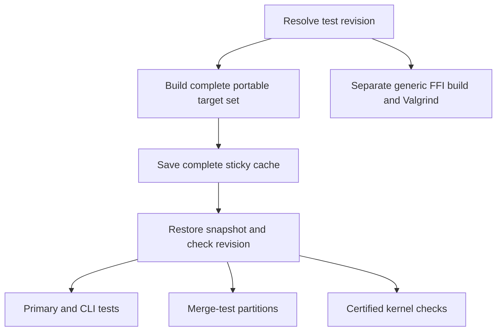

# CI build and cache design

Status: proposed common-producer design with a sticky-cache trial, updated
2026-11-06. The RunsOn v3.6.0 infrastructure update has been applied and the
repository's companion action pin is updated to v2.7.0. The trial uses the
existing merge build and read-only partitions; the common-producer refactor
below has not been implemented.
The existing workflow configuration is described in [CI configuration](ci.md).

## Objective

Build the portable Lean test targets once per CI invocation, then run the
test groups in parallel. One job owns the complete build cache. Test jobs
consume its outputs without publishing partial snapshots over that cache.
Every job, including building, cache transfers, setup, and cleanup, must fit
within 15 minutes. Aim for 10–12 minutes to leave headroom.

## Current problem

[`ci.yml`](../.github/workflows/ci.yml) combines building, primary tests,
linting, and CLI checks in `lean-test`. Its lint driver builds every root
library and executable target. On pushes to `main`, it skips tests but
refreshes the portable sticky cache.

[`merge-tests.yml`](../.github/workflows/merge-tests.yml) has another build job
for the slower test partitions. Both workflows run on `merge_group`, so
they independently build overlapping targets for the same commit. Sharing a
sticky-cache name does not make either workflow depend on the other's build.

In [run 42228523610](https://github.com/argumentcomputer/ix/actions/runs/42228523610),
the shared build took 8m03s, but all four partitions reported missing its
revision marker and repeated some compilation. The logs establish that the
handoff failed; they do not establish the exact control-plane cause.

Parallel writers create a separate problem. Each runner starts from its own
copy of a snapshot. RunsOn does not merge their changes: the last clean
completion becomes the newest snapshot for that repository, lineage, Git
ref, OS, and architecture. It can contain one partition's updates while
missing another's. Merge-queue snapshots do not overwrite `main`'s snapshot,
but jobs sharing the same queue ref can replace one another's cache state.
See [RunsOn snapshot lifecycle](https://runs-on.com/docs/runners/capabilities/sticky-disks/#scope-lifecycle-and-cost).

## One producer, parallel consumers



Extract the build portion of `lean-test` into the common producer. Both the
primary tests and merge-test partitions become consumers. Retaining the
existing `lean-test` builder alongside an independent merge-tests builder
retains duplicate compilation. The trial disables `lean-test`'s sticky saves
on `merge_group` to prevent competing writers while those jobs are separate.

The producer builds the union of targets required by its consumers: library
and executable coverage, `IxTests` and its dependencies, CLI tools, the ZK
voting prover, the standalone `IxC` package, certification audits, kernel
test executables, and the set-theory model when included in the build contract.
The designated writer of the canonical `main` cache must build the complete
set, even when its invocation skips test execution. Build target lists must
come from a shared definition so the producer cannot silently omit a
consumer's new dependency.

Test jobs may write temporary files to their own disks. They must use
`sticky_save: false` and must not save whole-tree archives back to the
producer's cache. A missing build target belongs in the producer's target
set. Reusable data generated by a test needs a separately owned cache if it
must persist.

Use one orchestration graph for the primary and merge checks on `merge_group`.
Calling the same reusable build workflow from two independent workflows
would still execute two builds. Preserve the pull-request fast path, the
authorized `!merge-tests` dispatch, and the existing required check names
`ci-gate / pass`, `merge-gate / pass`, and `nix-gate / pass`. The PR-only merge
stub must not replace the real merge-group result.

Nix, standalone Rust tests, CUDA builds, and benchmarks retain their separate
build contracts and cache lineages. Valgrind retains its generic build and
16-vCPU runner; its artifacts cannot use the portable AVX-512 build.

## Cache ownership and delivery

| Storage | Writer | Readers | Purpose |
| --- | --- | --- | --- |
| Portable sticky build cache | Complete build producer | Producer and test jobs | Warm incremental builds and supply built targets; consumers check the revision |
| sccache entries | Every compiling job | Every compatible compiling job | Reuse individual compilations keyed by compiler inputs |

Multiple sccache writers are safe for this purpose because their entries are
individually keyed. They do not replace one shared directory snapshot.

The trial uses sticky snapshots without an additional S3 archive save or
restore. It tests whether the RunsOn upgrade fixes the observed miss before
introducing another transfer mechanism:

1. The existing merge build warms the target and model caches, records the
   revision in `.lake/merge-build-revision`, and saves its sticky snapshot.
2. Partitions start after that job and mount the same lineage with
   `sticky_save: false`.
3. Before any local builds, each partition compares the restored marker with
   the requested revision. It records the expected revision, restored
   revision, and hit/miss result in its log and job summary.
4. A stale or missing marker warns; Lake still builds stale targets and runs
   the tests. A green test result alone is not evidence that the cache worked.

Pushes to `ix.ci-merge-tests` exercise this path using the pushed commit. The
build is the only writer in that workflow. CI Jobs' `lean-test` disables saves
on merge-group runs sharing the queue ref; its `main` push runs still seed
the default-branch snapshot. Consolidating the two builds remains separate
work.

The cached paths include `.lake`, `target`, and `Models/SetTheory/.lake`, plus
Cargo's dependency directories. `.lake/kernel` contains the standalone
kernel's build outputs. The producer warms the model cache because its
read-only consumer cannot refresh it.

`needs: build` alone does not demonstrate that the right snapshot was
selected. If misses remain after the upgrade, inspect the producer snapshot's
creation/completion times and the consumer's selected snapshot before choosing
a further fix. The explicit S3 handoff is not part of this trial.

## RunsOn update

The infrastructure is managed in
[`argumentcomputer/terraform-server/runs-on.tf`](https://github.com/argumentcomputer/terraform-server/blob/b3a5c47f5d8c1b2b0ebcdf82ee0d16ed3f98e33c/runs-on.tf).
Latest inspected `main` is `b3a5c47`; its Flex module is pinned to `3.6.0`,
and the deployment was confirmed applied on 2026-11-06. The earlier measured
merge-test run used v3.3.2, so it is not validation of the upgraded deployment.

The workflows pin the companion action to the verified v2.7.0 release:

```yaml
uses: runs-on/action@13fbb6a39310a0dac9ab4716da2c4e74a3326dfc # v2.7.0
```

The relevant changes are:

- [v3.4](https://github.com/runs-on/runs-on/releases/tag/v3.4.0) fixes cases
  where sticky caches rolled back to older snapshots. This is relevant to
  the investigation, but is not a confirmed explanation of the observed miss.
- [v3.5](https://github.com/runs-on/runs-on/releases/tag/v3.5.0) adds restore-only
  sticky disks. `sticky_save: false` requires RunsOn >=3.5 and action >=2.6.
  The producer saves; all test consumers disable saving.
- [v3.6](https://github.com/runs-on/runs-on/releases/tag/v3.6.0) improves large
  S3 cache restores and sticky-disk Spot recovery. It also adds
  [`remote_cache: sccache`](https://runs-on.com/docs/performance/caching/sccache/),
  an optional alternative to the existing `sccache: s3` setup. That change
  does not provide a Lean build-output handoff.

Expect initial misses from the v3.5 workspace-path change from
`/home/runner/_work` to `/home/runner/work`; absolute-path cache keys can change.
Confirm v3.6 in new runner logs before enabling version-dependent inputs.
Rebuild the canonical cache on `main`, then measure warm runs.

## Validation before rollout

- Confirm that only the complete producer saves the portable sticky lineage.
  Finishing a small partition must not replace its snapshot.
- Verify every consumer restores the producer's exact revision. Exercise
  missing and mismatched markers, and retries that reuse a successful build.
- Check that producer-owned Lean targets are not recompiled by consumers and
  that no required suite, audit, or merge gate disappears during restructuring.
- Measure each job, including transfers, against the 15-minute limit. The
  latest baseline has IxVM at 16m29s by itself, so isolating it from misc is
  only the first step; it still needs an internal split or optimization.
- If the complete build exceeds the budget, define separately owned artifact
  groups and cache lineages. Do not let partial builders compete to save the
  same snapshot.
