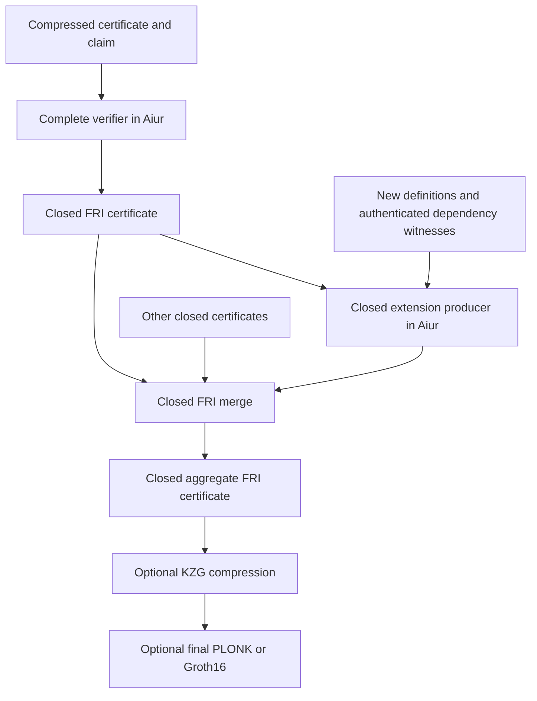

# Reusing compressed proofs through complete verification in Aiur

Status: proposed design, 2026-10-29. Source baseline: `kzg-bn254` at
`c6c6cb95`, including the current working-tree experiments. This document is
not a claim that the import verifiers or closed extension producer exist yet.

The current v1 implementation plan is the
[direct Aiur KZG verifier design](direct-aiur-kzg-verifier.md). It supersedes
the initial scope below: v1 uses direct verification, constrained same-basis
pairing accumulation, native pairing checks, and an explicit recompression
path. Complete in-Aiur pairing verification remains a longer-term target;
the experimental findings in this document remain reference material.

## Longer-term verification target

All verification of an imported compressed proof, including every pairing
check, runs inside Aiur. A FRI proof certifies that execution. Imported
certificates then enter ordinary FRI aggregation, where dependency membership
and assumption discharge are also checked.

Every certificate emitted by this workflow is closed. There is no intermediate
certificate that requires a base proof or an unchecked pairing equation to be
supplied later. A subsequent KZG, PLONK, or Groth16 stage only compresses an
already closed FRI result.

The conditional-root rebase and direct KZG merge experiments are not the
architecture specified here. In particular, this workflow does not emit
`CheckEnv(R_d, some R_base)` and wait for compression to discharge it.

## Goals and artifact contract

Support all three compressed input formats: recursive KZG, gnark PLONK, and
gnark Groth16. Each format is enabled only after its complete Aiur verifier is
implemented and validated. No unsupported format falls back to an unchecked
host verification result.

A reusable certificate consists of:

- The canonical claim bytes, including the claim kind, object/validator version,
  subject address or root, and assumptions option.
- Proof-system and encoding-version identifiers, verifying-key identity, and
  proof bytes.
- The applicable authorization-policy identity. Legacy formats obtain their
  policy interpretation from an explicitly approved legacy descriptor.

The existing [Ixon.Proof wrapper](../Ix/Claim.lean) already carries a claim and
opaque proof bytes. Extend/version the opaque certificate encoding where
needed; a bare compressed packet containing only a claim digest is insufficient
for claim composition. Verification keys can come from the release bundle or be
provided as advice whose digest is checked against that bundle's policy.

Importing or merging closed certificates needs no original `.ixe`, shard
manifest, aggregate FRI proof, proving key, or full Ignition proving SRS.
Verification anchors contained in approved verifying keys are sufficient.
Producing a new compressed output can require proving parameters for its
selected backend; that is separate from importing the inputs.

Aiur import support is also distinct from the optional gnark final proving
backends. An importer must not require the imported system's proving library
merely to establish its verification relation.

## What closed means

A closed certificate establishes either `Check(c, none)` or
`CheckEnv(R, none)` under an independently pinned authorization policy.

There are two closure requirements:

1. **Logical closure:** no typechecking assumptions remain in
   the public claim.
2. **Import verification closure:** every equation needed to verify an imported
   proof is checked in the Aiur execution. No imported pairing accumulator is
   exported as an obligation for another verifier or compression stage.

An Aiur execution may use temporary hypotheses internally, provided that the
same execution establishes and discharges them before emitting its claim.
This is different from producing a proof of a conditional claim.

Closed does not mean independent of cryptographic assumptions. A FRI wrapper
around a production SNARK still relies on the imported SNARK's approved setup
and soundness. A development-key proof stays development-only through import,
aggregation, and recompression; FRI wrapping cannot promote it into production
trust.

Ordinary verification equations of a newly produced KZG/PLONK/Groth16 proof
remain part of that format's complete verifier. The restriction here concerns
unfinished checks of imported inputs being carried out of Aiur.

## Architecture



Use a dedicated closed-certificate entrypoint, provisionally `ix_cert`, in the
aggregation program. It dispatches import, closed merge, and closed extension;
its output claim is constrained to be closed. The policy binds its verifier key
and exact entrypoint. Existing conditional-shard/rebase entrypoints are not
interchangeable with it, even when they share a compiled program key.

The result is an ordinary closed FRI child. Later merges use the existing FRI
verification machinery, with the closed entrypoint, policy, and claim checks.
Legacy FRI producers can enter only through explicitly approved import rules
that verify their claimed closure.

The imported FRI result can be cached and reused. Retaining this new cache is
an optimization, never a requirement to retain the original base FRI proof.

The proposed FRI statement retains the existing 18-word shape:
`[channel, cert_entrypoint, policy_digest(8), claim_digest(8)]`. The digests are
packed as little-endian 32-bit words. A matching program key without the correct
entrypoint and policy is insufficient.

## Operations and statements

### Import a closed environment

Given an approved descriptor, verifying key, compressed proof, and canonical
claim `CheckEnv(R, none)`, Aiur:

1. Authenticates the descriptor/key and the permitted input policy.
2. Parses the proof and claim with the descriptor's exact versioned encodings.
3. Checks the expected public-input mapping and complete proof verification.
4. Emits the same closed claim under the current policy.

An input with `some A` is rejected by the closed importer. A valid conditional
proof is not evidence for an unconditional claim.

### Import a definition

A definition certificate can carry `Check(c, none)`. An explicit lifting rule
verifies that typed claim, then emits a singleton subject-tree certificate:

```text
Check(c, none)  =>  CheckEnv(leafHash(c), none)
```

This is a constrained logical rule, not reinterpretation of a claim digest.
Its justification must match the semantic predicates of the approved kernel
validator. A singleton subject certificate asserts well-typedness of the
constant; it does not assert that a one-constant `.ixe` contains all dependency
bytes. Profiles that authorize only environment claims cannot import a
single-definition claim through an implicit cast.

Other claim kinds, such as evaluation, catalog membership, or resource claims,
need separate reviewed rules and are outside the initial scope.

### Merge closed environments

For two closed claims under the current policy:

```text
CheckEnv(R_left, none) + CheckEnv(R_right, none)
    => CheckEnv(nodeHash(R_left, R_right), none)
```

Both child proofs are verified inside Aiur. No leaf enumeration or membership
paths are needed for this operation. Mixed compressed formats first pass
through their complete importers; already imported FRI children are reused.

The result commits to a structural union, not necessarily the canonical flat
root of a merged `.ixe`. Overlapping content addresses are harmless to
well-typedness: they identify the same constant. Unique counts, name shadowing,
and name-to-address bindings are separate artifact/naming properties.

### Extend a certified environment with new definitions

The extension producer takes closed base certificates, new definitions `D`,
and witnesses for the base constants actually used while checking `D`.

One proven Aiur execution must:

1. Verify the closed base certificate or its cached closed FRI import.
2. Authenticate the supplied definition/type/body bytes by content address.
3. Check Merkle membership of every external constant admitted as already
   checked against a verified base subjects root.
4. Execute the kernel checks for the new definitions, including their internal
   dependencies and mutual-definition blocks.
5. Emit `CheckEnv(nodeHash(R_base, R_D), none)`, or the corresponding structural
   union with multiple verified bases.

The base is established within this execution before dependency assumptions
can justify the output. No separate proof of `CheckEnv(R_D, some A_D)` or
`CheckEnv(R_D, some R_base)` is produced or persisted.

This requires a closed extension producer, not merely a wrapper around the
current conditional shard prover. Kernel execution, base-certificate
verification, and dependency discharge must be composed in the same proven
program/execution. Any trusted-state shortcut in the kernel must be reachable
only through the checked certificate and membership relation.

### Sharding and parallelism

The existing sharded workflow can emit conditional shard proofs. Reusing that
workflow unchanged would not meet this design's closure requirement.

For the closed workflow, schedule dependency-closed batches relative to
already certified bases. Include mutual blocks atomically. Independent batches
can run in parallel; batches with new cross-dependencies wait for the relevant
closed predecessor certificates or are grouped into one execution. Each batch
verifies its bases and emits a closed result. Shared base subjects may occur
in several outputs without weakening the well-typedness claim.

Execution records and trace-shard pieces can be checkpointed while constructing
one proof. They are incomplete construction artifacts, not independently
accepted certificates. Only a completed, verified batch can be published or
used as a child. There is no conditional-proof fallback when a workload does
not fit; regroup it or use the existing trace-sharding machinery within a
closed producer.

## Complete compressed-proof verification in Aiur

Aiur currently runs over [Goldilocks](../crates/aiur/src/lib.rs). The existing
[KZG verifier](../crates/proof-compression/src/recursive/native_verifier.rs)
uses BN254 scalar-field arithmetic and defers its pairing equation. It is a
reference for verification logic, not an implementation that can be inserted
unchanged into an Aiur FRI proof.

Required constrained primitives include:

- BN254 scalar-field and base-field arithmetic with canonical representations,
  modular reduction, multiplication, inversion, and range/carry checks.
- Extension-field arithmetic, curve operations, scalar multiplication/MSMs,
  and complete pairing verification, including final exponentiation or an
  equivalently complete, reviewed constrained check.
- Canonical point decoding, curve/subgroup checks, and protocol-correct handling
  of infinity and exceptional cases.
- BLAKE3 and SHA-256 wherever the respective protocol requires them. The existing
  Aiur BLAKE3 implementation can be reused; hashes are not interchangeable.

Both BN254 fields are foreign to Goldilocks. The current native verifier's
80-bit limb representation cannot be reused in a 64-bit field. Limb widths,
carry bounds, and lookup layouts must be selected with explicit no-wrap
arguments and then measured.

| Input | Checks that must finish inside Aiur |
| --- | --- |
| Recursive KZG | Full transcript, algebraic/lookup relations, opening verification, and the inherited deferred pairing equation. Today's format requires both its outer KZG opening check and its inherited pairing check. |
| gnark PLONK | The complete versioned gnark verifier: public inputs, transcript, polynomial identities, commitment extensions, curve operations, and KZG pairing check. |
| gnark Groth16 | The complete Groth16 pairing equation and all gnark commitment/hash-to-field extensions present in the approved profile. Ordinary A/B/C verification alone is insufficient for the current commitment-augmented format. |

Initially check each imported proof completely. Pairing batching is an optional
later optimization only if all applicable equations are included, bases are
compatible, and challenges bind all inputs. The combined equation must still
be checked inside Aiur. Different setup anchors cannot be silently folded into
one fixed-base accumulator.

Host-native verification can reject bad inputs early and serve as a differential
reference. It cannot provide a trusted boolean to the circuit. CPU/CUDA witness
hints, precomputed pairing lines, and specialized arithmetic instructions are
usable only when their correctness is constrained or their fixed data is bound
to the approved key/program. Sppark remains primitive acceleration; Ix/Aiur owns
the workload and verification semantics.

## Authorization policy and recursion identity

Generalize the current [allowed blob](../Ix/Aggr/Circuit.lean) into a versioned,
canonical policy commitment `P`. It authorizes the kernel/certificate producers,
aggregation verifier, compressed input descriptors, and their claim semantics.
The native verifier independently pins `P`; a proof cannot choose its own trust
policy.

A descriptor binds at least:

- Proof family, encoding version, and digest of the actual canonical key bytes.
- Native packet key identifier and any required setup anchors/profile identity.
- Validator/object version, accepted claim kinds, entrypoint, and public-input
  mapping, including the expected legacy statement prefix where applicable.
- Whether the child must use the current policy, or an explicitly approved
  fixed legacy policy/context.
- Production/development classification and relevant resource limits.

Descriptors can be authenticated by a canonical Merkle commitment. The policy
header binds its format, semantic validator, security class, bounds, and
record-tree root. Membership advice is checked in Aiur. This is an extension
of the release's existing allowed-key binding, not a proof-supplied catalog.

A same-policy descriptor uses the symbolic rule `SamePolicy`; it must not
contain the numeric digest of the policy that contains it. Otherwise the policy
hash would itself require a fixed point. Explicit legacy rules can contain an
already known legacy policy digest or baked statement prefix.

For current-policy children, constrain both the actual verification-key digest
and the child's public policy digest. Every recursive child must carry the
same `P` as its parent. This prevents a valid child from concealing an earlier
step performed under an unauthorized policy. Policy transitions are explicit
imports under pinned legacy descriptors, not arbitrary parent relabeling.

Development keys are never authorized by the production policy. Importing one
requires an explicitly authorized development policy, and every output remains
under that policy. A native verification flag alone cannot authorize an input
key inside the circuit.

In particular, the currently bundled 0.1 Groth16 key uses development setup;
its legacy import is development-only.

## Same-release round trips without circular keys

A release must be able to compress a closed FRI certificate and later import
that compressed output using the same released keys. Hardcoding those output
keys into the Aiur program would make its key depend on its own compression
keys.

Keep circuit identity separate from policy values:

1. Compile generic Aiur verification/aggregation/extension programs. Their
   instruction graphs contain verifier algorithms and bounds, not the concrete
   current policy or compression-key bytes. Keys and policy records are checked
   witness inputs; `P` is public.
2. Select a fixed normalization layout and derive the FRI/KZG compression keys.
   The policy words remain public through every compression stage, so these
   keys do not depend on the value of `P`.
3. Compile and set up final PLONK/Groth16 circuits with public policy and claim
   digests. Their keys also do not depend on `P`.
4. Construct the release policy from the now-known keys, including current
   compressed keys and explicitly permitted legacy inputs. Compute `P`.
5. Pin `P` in the native release bundle and application-level Solidity adapter.
   Supply it as a public input when proving and verifying.

The resource profile must also be closed under this round trip. Bound accepted
key/proof sizes, parameter dimensions, policy witnesses, and FRI batch sizes;
derive candidate keys, then establish that importing their actual outputs and
wrapping the resulting FRI certificates fits the selected layout. Increase the
profile and rederive before release if necessary. Changing layout/keys after
each extension is not same-release reuse.

This requires a change to the current final circuits. Their
[exported prefix](../crates/proof-compression/src/pipeline/wrap/outer/final_export.rs)
is currently baked into the [gnark circuit](../tools/plonk-wrapper/circuit.go).
Baking a policy containing the final key into that circuit recreates the cycle.

The proposed new final public inputs are four range-constrained 128-bit limbs:
`policy_lo`, `policy_hi`, `claim_lo`, `claim_hi`. Each digest uses little-endian
halves. The final circuit binds the policy limbs to the inner statement's policy
words and the claim limbs to its claim digest. Channel/entrypoint constants can
remain fixed. Legacy two-limb proofs use separate approved descriptors.

Native and Solidity application verifiers must compare the policy to their
independently pinned expected value, not simply accept a policy supplied with
the proof. One verifying key per proof system per release is retained; the
application also pins the authorization policy. Serialization, final public-input
counts, and verifier adapters need a versioned migration.

## Data availability and Merkle witnesses

| Operation | Base data needed beyond its certificate and approved verifier |
| --- | --- |
| Import a closed certificate | None |
| Merge closed certificates structurally | None |
| Check new definitions using the base | Referenced constant data and authenticated membership paths |
| Reconstruct a particular `.ixe` or canonical flat root | The relevant environment data/index |

A compressed proof authenticates a root; it cannot reconstruct the constants,
types, bodies, or Merkle paths beneath it. Dependency witnesses can come from
existing Lean/Ixon artifacts, a content-addressed store, or an untrusted server.
Their authenticity is checked in Aiur against the verified base root.

Publish/cache the subject-tree index or provide membership multiproofs. Rebuilding
that index from all base addresses is an optional host operation with cost
proportional to the base; it is not described as proof-only or constant-cost.
Only base data actually used by the kernel must be supplied/authenticated, but
this can include definitions reached during reduction, not just direct
syntactic references. Avoiding base typechecking does not make evaluation of
referenced definitions free.

## Structural roots and path depth

Repeated `nodeHash(base, delta)` appends deepen old leaves. Existing membership
paths have a 64-step limit; a claim of unlimited incremental extension would be
incorrect without a balancing strategy.

Use balanced merge planning and retain an authenticated persistent tree index.
The initial implementation must enforce an explicit path bound and reject an
unsupported extension before publishing a certificate. Pure closed-certificate
merge does not need membership paths and is not subject to this particular
limit.

A follow-on closed reassociation rule can verify a closed certificate and node
openings, constrain rotations that preserve the subject leaves, and emit a new
closed root. This needs authenticated tree nodes, not old FRI proofs or constant
payloads. It is required before promising efficient arbitrary-length extension
chains for skewed legacy roots. Raising the path cap alone is not balancing.

## API and checkpoint boundaries

Expose three operations, with final CLI spelling reviewed separately:

| Operation | Input | Output |
| --- | --- | --- |
| Import | Compressed certificate and approved verifier/policy advice | Closed FRI certificate |
| Merge | Two or more closed certificates, automatically importing compressed inputs | Closed aggregate FRI certificate |
| Extend | Closed base certificates, delta definitions, dependency witnesses | Closed extended FRI certificate |

Accept proof-wrapper files or store addresses and allow portable certificate
output. Integrate closed certificate inputs into aggregation and base inputs
into proving; do not repurpose the existing `ix merge` environment-file command.
The existing compression command consumes the resulting closed FRI root.

Import cache identity includes input proof/claim bytes, proof format, key,
policy, and importer program/version. Reuse requires a valid closed FRI proof
under the expected policy and an exact statement match. A cache hit or native
base-proof check is not a substitute for that certificate. Fresh mode may
bypass proof caches while retaining fixed preprocessing.

Public import, extension, aggregation, compression, and verification entry
points enforce closure. A conditional legacy proof may be reported as such by
a diagnostic interface, but cannot be accepted or labeled as a closed child.
Intermediate checkpoints in this workflow contain only closed certificates or
explicitly incomplete construction artifacts, never conditional certificates.

## Implementation work

1. **Arithmetic and decoding.** Add constrained BN254 scalar/base/extension-field,
   curve, pairing, and required hash routines under the Aiur library. Reuse
   native verifiers as references and witness accelerators. Prove range/carry
   invariants before freezing layouts.
2. **Complete importers.** Implement typed KZG, PLONK, and Groth16 verification
   entrypoints. Start with one fixed legacy profile per backend, then enable
   the generic current-policy profile. No backend is advertised before its
   complete verifier is implemented.
3. **Closed producers and FRI aggregation.** Add the closed certificate entrypoint
   and its import/merge operations, plus a producer that composes kernel checking
   with verified-base dependency discharge in one execution. Adapt planning so conditional shard
   proofs and the external-root rebase shape do not enter this workflow.
4. **Policy and codecs.** Extend allowed-key advice, bind policy identity through
   children, define the closed certificate transport, and authorize legacy
   keys/prefixes explicitly. Native verification must mirror the claim rules.
5. **Compression and final wrappers.** Carry policy as public data; update final
   circuit public inputs and Solidity adapters. Derive all new keys and the
   policy in the non-circular order above. Existing keys remain legacy inputs,
   not silently reinterpreted new-profile keys.
6. **Host integration.** Add certificate input resolution, dependency/index
   witnesses, closed batch scheduling, import caching, and file/store output.
   Preserve original proof artifacts for reproducible migration tests.

Relevant existing components are [aggregation](../Ix/Aggr/Circuit.lean), its
[host controller](../crates/ffi/src/aiur/aggregate.rs),
[claim encodings](../Ix/Claim.lean), [Merkle operations](../Ix/Merkle.lean),
[compressed verification](../crates/proof-compression/src/pipeline/mod.rs),
[complete recursive KZG verification](../crates/proof-compression/src/pipeline/stages/verification.rs),
and the [final gnark backends](../tools/plonk-wrapper/README.md).

## Cost and validation gates

Full non-native verification is the main cost risk. For a fixed input profile,
import cost depends on the verifier/key/proof dimensions, not the number of
constants represented by its root. It can nevertheless be substantially more
expensive than the direct BN254-field merge proposal. Native millisecond
verification measurements do not predict Aiur trace cost.

Measure field operations, curve/MSM work, a complete pairing check, then full
imports. Record execution rows/cells, witness generation, CPU/GPU proving time,
peak host/device memory, FRI proof size, compression cost, and cold/warm reuse.
Do not assume today's normalization layout, 2.1 KB compressed size, or final gas
costs survive the changes. If costs are excessive, optimize checked arithmetic
or dedicated AIR operations; do not substitute deferred checks or conditional
certificates.

Required validation, when machine time is authorized:

1. Import each approved compressed format using only its certificate and public
   verifier bundle. Remove old FRI proofs, proving keys, proving SRS files,
   environments, and manifests from the disposable test input.
2. Merge two closed imported certificates with no base environment/index and
   verify the structural output claim. Exercise definition-to-environment lifting.
3. Extend a base using only the required dependency data/paths. Reject wrong
   payloads, foreign dependencies, invalid paths, and incomplete coverage. Verify
   that every persisted certificate has `assumptions = none`.
4. Reject a recursive KZG input with a valid outer proof but an invalid inherited
   pairing equation, and reject invalid PLONK/Groth16 opening or commitment checks.
   Exercise the constrained importer directly, bypassing optional host prechecks.
5. Reject unapproved keys, wrong entrypoints under an otherwise valid program
   key, changed program prefixes, policy substitution in any
   child, wrong claim kind/validator, malformed/trailing encodings, noncanonical
   field/point encodings, and forged arithmetic hints.
6. Verify policy-independent circuit/key construction. With the same circuit
   and setup, reuse one prepared keypair for proofs under two policies; each
   application verifier must reject the other policy. Do not compare independent
   random Groth16 setups as a determinism test.
7. Compress, import, extend/merge, and recompress for several rounds under the
   same release keys and policy. Include explicitly approved 0.1 imports, with
   no regeneration of the old library's proof.
8. Exercise path-depth limits, balanced planning, overlapping subject addresses,
   partial checkpoint recovery, and policy/key/version cache invalidation.
9. Compare CPU, interpreter, generated execution, and CUDA paths against the
   native verifier vectors. Development inputs must never yield a production-
   policy certificate.

Until these checks and sizing measurements pass, this remains a protocol and
implementation design, not a supported compressed-proof reuse path.

## Findings from the direct KZG experiments

These measurements come from the experimental conditional-rebase and direct
KZG merge path (commit `91311d02` and the uncommitted 0.2 work on 2026-10-30).
That path is not this design, but its results bear on this design's cost risk
and on parts it can reuse.

### What was built and measured

| Piece | Result |
| --- | --- |
| `ix_aggr` shape 13 (external-root rebase) | A one-theorem extension of Nat.add_comm sharded, proved, aggregated and rebased in 13.7 s (20.9 GB peak); 6 assumptions discharged onto the base root by Merkle paths. `ix verify` accepts it and labels it conditional. |
| Extension-mode preparation | Base constants become external owners; `ix shard/prove/verify --base-ixe/--base-ixes/--base-structural-above` work end to end. |
| Recursive verifier refactor | Splitting the in-circuit verifier into reusable steps left the 0.1 recursive key byte-identical (`b4c58f79…`). |
| KZG merge family | Five shapes (join of fresh/merged children, relay of 0.1 imports) under one family digest; each member is 2^24 main rows and 2^21 table rows, a 1,542-byte key, derived in 50 s with 20.5 GB peak. The recursive stage it builds on is 2^27-capped and takes 82.6 GB to derive. |
| 0.2 keys | New aggregation key (`fa2aca38…`), 103-circuit layout, recursive key `a2488d06…`, merge family `f0119385…`. Nat compresses and verifies under them. |

The merge circuit's size depends only on the input certificates' fixed shape,
never on the libraries their roots cover: a Nat and a Mathlib certificate are
the same size under the same key.

### Bearing on this design

- **Cost baseline.** Verifying two recursive KZG certificates in-circuit,
  deferring their pairings, costs 2^24 rows in BN254's own scalar field. The
  same verification in Goldilocks must emulate both BN254 fields and add
  complete pairings, including final exponentiation. Measure one complete
  BN254 pairing and one certificate's MSM in Aiur first; that number decides
  whether an import takes minutes or hours. Each Aiur import, merge or extension
  is also followed by a full recompression (FRI, first KZG, recursive), about
  3 to 4 minutes warm on one RTX PRO 6000, where a KZG merge is one stage.
- **Reusable pieces.** The membership-path discharge (shape 13's
  `aggr_discharge_choice`/`aggr_fold_path`, host `rebase_path_advice`) and
  extension-mode preparation (`prepare_run_with_base`) supply the extension
  producer's dependency witnesses. The claim rules are identical:
  `CheckEnv(nodeHash(R_L, R_R), none)`, overlap harmless. The merge family's
  digest `S`, carried by every child and checked against its parent, is the
  same mechanism as policy `P`.
- **Recursion identity is cheap in KZG.** Verifying under a key that is a
  witness bound to a family digest worked because only the key's fixed
  commitments vary; every member shares one lowered constraint system, padded
  to the largest member's heights. The heights settled after one rebuild.
- **Pairing bases.** Folding pairings needs every input to share `[1]₂, [τ]₂`.
  Under Ignition every stage does. Development setups derived a trapdoor per
  stage; the experiments made the first KZG, recursive and merge stages share
  one development seed. This design's batching caveat ("different setup
  anchors cannot be silently folded") matches what the code had to enforce.
- **Legacy imports.** Only certificates under the bundled 0.1 recursive key
  (`376163…`) can be imported. The saved Init recursive proof
  (`target/fixed-root-20261029/kzg2-init-2`) is under an earlier key
  (`2ee175…`), so this design's "explicitly approved 0.1 imports" covers Nat's
  0.1 proof but not that Init proof.
- **New key versions are expensive.** Changing the aggregation circuit changed
  the root key, layout and recursive key, so every workload was re-aggregated:
  Nat 13 s, Init 2 min, Mathlib 33.5 min (shard proofs reused). The generated
  trace code (`crates/aiur/src/trace_codegen/programs/ix_aggr*`,
  `crates/aiur/cuda/generated/production/ix_aggr.cu`) must be regenerated with
  the circuit, or `ix codegen --check` fails. This design changes the
  aggregation program too, so it pays the same migration.
- **Root wraps need trace-sharding settings.** Without
  `AIUR_TRACE_ONLY_LOOKUPS=1 AIUR_MAX_PIECE_LOG_HEIGHT=24
  AIUR_TRACE_SHARD_MAX_CELLS=1500000000`, Init's root wrap produced 375M cells
  in 58 shards. Import executions with large foreign-field traces will need the
  same settings, or defaults that apply them.
- **Parameters.** The gnark-format Ignition SRS (`srs.bin`, SHA-256
  `06db33d8…`) is reproducible from the Ix S3 mirror of the final two
  contributions alone and reproduces the 0.1 recursive key, so verification
  anchors for imports can come from approved keys without Aztec's servers.

### Join measurements

One RTX PRO 6000, Ignition parameters, 0.2 keys, 2026-10-30.

| Operation | Inputs | Output | Wall time | Peak RSS |
| --- | --- | --- | --- | --- |
| Compress rebased Nat extension | `45373bd8…` | `2fa95a72…` | 7m08s | 194 GiB |
| Compress Init root | `50e6d286…` | `265cd4a2…` | 9m29s | 194 GiB |
| Import Nat 0.1 (relay) | `inproc/nat` | `481a2c2a…` | 1m54s | 19.4 GiB |
| Join(merged Nat, fresh extension) | `481a2c2a…`, `2fa95a72…` | `e570e831…` | 1m41s | 19.9 GiB |
| Prove and rebase `init-ext` (6 new constants, 81 assumptions onto Init's root `ca439dce…`) | `init-ext.ixe` | `860cc92f…` | 29 s | 14.2 GiB |
| Compress rebased `init-ext` | `860cc92f…` | `502af3be…` | 7m16s | 194 GiB |
| Join(fresh Init, fresh `init-ext`) | `265cd4a2…`, `502af3be…` | `7512f2db…` | 2m08s | 19.8 GiB |
| Prove and rebase `init-ext2` (2 new constants, 8 assumptions) | `init-ext2.ixe` | `b2e7e496…` | 18 s | 9.8 GiB |
| Compress rebased `init-ext2`, after the fixed-cache fix | `b2e7e496…` | | 3m47s | 193 GiB |
| Join(fresh Init, fresh `init-ext2`), warm merge cache | `265cd4a2…` | `5ab3ea44…` | 15 s | 15.7 GiB |
| Compress Mathlib root (783,115 constants) | `9af040fd…` | `55513632…` | 3m50s | 194 GiB |
| Join(fresh Init, fresh Mathlib), two closed certificates | `265cd4a2…`, `55513632…` | `d5ea6dd1…` | 12.4 s | 15.7 GiB |

Joining Mathlib costs the same as joining a two-definition extension, and the
joined proof is the same 1,917 bytes: merge cost is independent of the
libraries the inputs cover. Mathlib's environment contains Init's constants,
so the two subject sets overlap; that is harmless, since one address is one
constant.

Rejected before proving, in about 1.4 s each: Init joined with an extension
rebased onto Nat ("the right claim assumes a root other than the left"), the
extension on the left ("the left claim of a merge must be closed"), and an
extension joined with itself. These are host checks; the circuit's own
enforcement is covered by unit tests only.

Most of a warm compression and of a cold merge was copying fixed
preprocessing. The cache lived on another filesystem, so restoring it copied
69 GB into every compression output and 8 GB into every merge. With fixed
columns read from the cache in place, a warm compression fell from about
7m15s to 3m47s and a warm merge to 15 s, and outputs shrank to megabytes.

The joined proof is 1,917 bytes, the size of a compressed proof, and
`ix verify` accepts it under Ignition. A merge step costs about a quarter of a
compression and a tenth of its memory.
