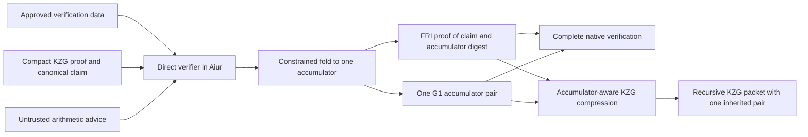

# Direct Aiur verifier for recursive BN254 KZG certificates

Status: proposed implementation design, revised after review on 2026-10-30.
This design is recorded on `kzg-join`. The reviewed implementation baseline is
`kzg-bn254` at `8c6ac3be` (`c6c6cb95 → d893a81f → 8c6ac3be`); the join
reference is `kzg-join` at `51a17483`. `kzg-bn254` has since advanced to
`2f956090` through module/tooling consolidation and build changes, which must
be reconciled when implementing the port. The measured IR prototype remains
in `aiur-compressed-aggregation`
on the earlier `d2c33b50` history; that is not the current `kzg-bn254` baseline.
This design does not claim that the direct verifier, accumulator folding, or
recompression changes are implemented.

## Decision and scope

Write the KZG verification algorithm as Aiur functions. Aiur reads the
compact proof, authenticates verification data, replays the transcript,
checks the polynomial identities, and computes the opening MSMs directly.
Fr and Fq are each emulated once over Goldilocks. BLAKE3 runs through Aiur's
byte/u32 operations, including its XOF mode.

Retain the pairing boundary: Aiur derives the outer opening equation and the
equation inherited from the recursive KZG proof, then folds them into one
equation under an approved common G2 basis. Every certificate carries exactly
one accumulator pair, and joins fold child accumulators inside Aiur. Complete
native FRI-certificate verification checks that one equation. Per-proof
preparation/proving does not evaluate pending proof-opening pairings. No Miller
loop or final exponentiation runs inside Aiur. Fixed setup-anchor validation
is a separate, once-per-profile admission step described below.

The first version supports the current BLAKE3 recursive BN254 KZG packet and
canonical closed `CheckEnv` claims. V1 includes certificate joins, extension
and assumption discharge, constrained pairing folding, authenticated fixed-base
tables, and recompression back into a recursive KZG packet with one inherited
pair. Direct PLONK/Groth16 import, direct `Check` claim lifting, mixed-basis
accumulation, and in-Aiur pairings are separate work. Existing final
PLONK/Groth16 wrappers are consumers of the recompressed KZG result.



The implementation must not call `native_verifier::Plan::compile*`, export
its millions of gates, or interpret a native verifier witness vector. The
native verifier remains a differential reference.

### Branch dependencies

The implementation targets `kzg-bn254`, with explicit ports from the join work;
it must not assume that the old prototype's join machinery exists there.

| Piece | Source / action |
|---|---|
| Ordinary KZG verification and compression | Reviewed `kzg-bn254` baseline `8c6ac3be`; reconcile later commits before porting |
| Same-basis checks and constrained random-linear folding | Adapt the formulation in `kzg-join`'s `native_verifier/merge.rs`; introduced in `6b54d511` |
| Canonical-assumption discharge helpers and path conventions | Carry the required helper logic from `6b54d511` into the new certificate path |
| Legacy rebase shape 13 | Optional compatibility with an explicitly admitted `kzg-join` producer; not required for canonical-assumption extension |
| Common development setup basis | Carry the join branch's common-basis rule into an explicitly versioned compression profile |
| KZG merge families, join CLI, and bundled 0.2 keys | Not dependencies of the Aiur certificate path; do not import wholesale |

Canonical-assumption extension verifies each dependency path into the proven
base directly, so it need not first produce a shape-13 rebase proof. If the
root-assumption shortcut is supported, its producer key/claim semantics must
be explicitly admitted; it is not an assumed feature of current `kzg-bn254`.
Retain source-commit attribution for carried code. New certificate/compression
layouts receive new keys; existing release layouts and pins stay versioned.

## Why replace the current path

The current importer checks a native Fr circuit inside Aiur. That circuit
already implements Fq curve arithmetic using Fr limbs, so Aiur emulates the
intermediate field as well. Its transcript XOF is expanded into scalar-field
bit arithmetic. The interpreter also materializes its program and witness as
byte lists.

The native fixture measured in the prototype on 2026-10-30 has a 1,917-byte
KZG proof but exports 3,876,131 gates, a 678,317,089-byte
program, and 1,588,906,074 bytes of arithmetic witness. Its full execution
inside Aiur has not been proved.

The direct path removes the expanded verifier circuit and its wire vector.
Arithmetic advice remains necessary, and MSMs remain expensive. Smaller input
artifacts alone are not a performance result: the direct path must be measured
and proved on the real small fixture before adding broader format support.

## Compatibility references

| Concern | Reference implementation |
|---|---|
| Portable key, packet identity, setup admission | [wrap/outer.rs](../crates/proof-compression/src/pipeline/wrap/outer.rs) |
| Compact proof encoding | [kzg/compact.rs](../crates/proof-compression/src/kzg/compact.rs) |
| Shape, opening rows, batch order, graph validation | [native_verifier/shape.rs](../crates/proof-compression/src/recursive/native_verifier/shape.rs) |
| Canonical observations and challenge generation | [kzg/transcript.rs](../crates/proof-compression/src/kzg/transcript.rs), [native_transcript.rs](../crates/proof-compression/src/recursive/native_transcript.rs) |
| Scalar identities and opening coefficients | `verify_opening` in [native_verifier.rs](../crates/proof-compression/src/recursive/native_verifier.rs) |
| Point encodings and native group results | [kzg/curve.rs](../crates/proof-compression/src/kzg/curve.rs), [native_curve.rs](../crates/proof-compression/src/recursive/native_curve.rs), [native_msm.rs](../crates/proof-compression/src/recursive/native_msm.rs) |
| Inherited pairing operands | [recursive/pairing.rs](../crates/proof-compression/src/recursive/pairing.rs) |
| Certificate composition and complete verification | Prototype-only `Ix/Aggr/Certificate.lean` and `crates/proof-compression/src/aiur_import/certificate.rs` in the `aiur-compressed-aggregation` worktree |
| Same-basis equation folding | `git show 51a17483:crates/proof-compression/src/recursive/native_verifier/merge.rs` on `kzg-join` |

The relative links resolve on `kzg-join`. Use the branch/commit matrix above
when porting them. Prototype-only files are identified explicitly: they are
not included with this design commit. The native merge module is not part of
current `kzg-bn254`.

Compatibility means matching the existing accepted relation and canonical
encodings. Do not substitute conventional PLONK transcript labels, normalized
Lagrange selectors, parity-based point signs, or a different challenge sampler.

## Verification data and its authentication

Derive a compact verification-data blob from the independently pinned portable
key, without a proof or proving SRS. It contains the original verifier data:

- The native packet key ID and exact transcript seed/kind.
- Circuit metadata and the original AIR expression graphs, constraint roots,
  and lookup descriptions.
- Fixed commitments, the G1 opening generator, trace heights, opening windows, quotient
  widths, and the canonical opening-batch schedule.
- The complete claim-row template, including the activation anchor and the
  locations of the 22 public values.
- Public setup identity/range information needed to reproduce admission.
- Authenticated window tables for the G1 generator and fixed commitments,
  including table width, point encoding and the base-to-table mapping.

The G1 generator used in `-y_j * generator` is explicitly part of the
verification data; the G2 anchors alone are insufficient.

The source-key BLAKE3 digest and the native packet key ID are different
identities; retain both. The packet carries the latter.

The current portable-key version fixes two partitions, with main widths
`[3, 1]`. The initial decoder should support exactly the admitted native
profile, including all-active traces, exact preprocessing heights, degree
bounds, nonzero G2 anchors, and BLAKE3. Reject unsupported key versions,
transcripts, shapes, or graph operations explicitly.

### The original AIR graph is legitimate verifier input

The compact key describes the polynomial relations proved by the KZG system.
The direct verifier must evaluate those expressions at the challenge point.
Use a bounded, topologically checked graph evaluator for that purpose.

This graph comes from the key being verified. It is not the expanded circuit
implementing the verifier. Its serialization must scale with the original
key's graph/commitments, not with the millions of gates in
`native_verifier::Plan::compile_relation()`.

Graph validation must cover node indices, earlier-node references, legal
columns and opening rows, the four public scalars, constraint roots, lookup
arguments/multiplicities, and consistent derived metadata. Cyclic advice must
not satisfy a graph walk. Use constrained counts and `child_index < index`.

### Trust boundary

Introduce descriptor version `IXAIKG02`. Its digest remains the import anchor
in the certificate policy. It binds the source-key digest, verification-data
digest, source statement prefix, outer and inherited G2 anchors, candidate
setup class, and the direct-verifier version. Version 2 also needs an
authenticated shape/size budget for the verification data. Do not freeze the
old 409-byte layout: the descriptor codec must include those bounds, either
directly or through a fixed-size shape record authenticated by the policy.
The different magic prevents reinterpretation of an IR descriptor.

A source-key digest alone does not authenticate a prover-selected translation.
Verification data must be derived by the verifier's trusted deterministic
deriver or distributed with an independently approved descriptor/policy.
Release regeneration compares the derived data against the pinned source key
and derivation version. No request may choose its own expected profile digest.
This does not require a catalog: one key, descriptor, and policy per approved
release/profile is sufficient.

The independently pinned policy decides setup admission. It records the
approved basis, source profiles and their admission classes, and the output
trust class. A descriptor's setup-class byte is a claim to compare against
that policy, not authority to classify itself as Ignition. Native admission
derives the source class from the actual parameters and approved release
anchors. Aiur authenticates the policy and descriptor, constrains their class
and basis agreement, and checks the data's structure. Any admitted development
source forces a development output policy; caller opt-in is still required.
Wrapping, folding, or a final proof must not promote its class.

One existing check needs explicit separation: [VerifierParams::from_bytes](../crates/proof-compression/src/kzg/verifier_params.rs)
evaluates a native pairing to check consistency of the fixed SRS anchors.
Perform that check when creating the admitted profile, then reuse the
validated parameters. The per-proof preparation API must not repeatedly
deserialize/revalidate the key or call its complete proof verifier. This
preserves setup admission without putting pairing work in the Aiur prover.

## Execution and advice model

The direct verifier takes:

1. The authenticated descriptor and verification data.
2. The existing tagged compact KZG packet and canonical claim bytes.
3. Typed arithmetic/decompression advice.

It derives two typed pairing equations, constrains their fold, and returns one
accumulator. The certificate entrypoint serializes that accumulator canonically
and checks its BLAKE3 digest against the public statement. It must compute the
outer operands itself and recover the inherited operands from the authenticated
proof statement. A supplied sidecar is only an output candidate to compare
against these results.

### Bounded reads, not a global witness byte list

Use a cursor over indexed IO bytes with constrained offsets, fixed record
widths, checked arithmetic, and bounded counts. Keep small proof/key buffers
only where they help parsing or hashing. Long arithmetic advice must not pass
through `read_finite_byte_stream` as one linked list.

Keep 64 MiB solely as the native portable-key decoder's defensive limit. It is
not an admitted Aiur hashing workload. For each approved profile, derive exact
section lengths and an exact canonical verification-data length from the
graph, commitments, claim template, schedule and fixed-table counts. Put that
length and its count bounds in the small authenticated descriptor. Aiur first
authenticates the bounded descriptor, then checks the data length before
reading/hashing its payload. Nested counts must match the admitted shape;
padding and trailing sections are rejected.

Ordinary verification data should be kilobytes for the two-partition profile;
the fixed tables add a calculable amount, potentially tens of kilobytes. The
release manifest must report both byte length and BLAKE3 compression count.
A larger valid host key does not automatically authorize a larger Aiur profile:
that requires a new explicit profile/resource admission. Proof length is exact
for the profile. Bound arithmetic record counts from the shape and algorithms,
not from a witness-supplied count. Execution/prover memory budgets remain a
separate host check; exhausting one must not emit a certificate.

Use fixed-width arrays or pointers to fixed-width arrays for field elements,
carry records, points, and transcript blocks. Small transcript observations can
use finite buffers; do not concatenate every scalar-operation witness into the
hash input or materialize it as recursive byte-list nodes.

The first host implementation supplies a deterministic advice tape. The Aiur
algorithm selects the operation and operands, then consumes only its result,
quotient/carries, or auxiliary coordinate. A record cannot select a different
operation or substitute operands. All fields are checked before use, and the
parser checks exact consumption and version-specific bounds. Caching repeated
arithmetic is allowed behind the same checked relations.

Native hint generation mirrors the direct algorithm using arkworks/BigUint.
It must not build the old verifier circuit or call a complete native KZG
verifier as a precheck. Factor phase helpers from native verification as
needed so preparation can obtain challenges, coefficients and group results
without executing pairings. Avoid diagnostics helpers that implicitly call
complete proof verification.

## BN254 arithmetic over Goldilocks

Provide distinct `Fr` and `Fq` types and APIs. A value is a canonical 32-byte
little-endian integer represented by sixteen 16-bit limbs. There is no
implicit field conversion. Bytes/limbs are checked; results and ordinary
product quotients are canonical in their selected field.

Retain the checked integer relations and bounds from the prototype's
`Ix/Aiur/Library/Bn254.lean` when porting that library. Replace list traversal
in hot operations with fixed-width access and bounded or unrolled column kernels.
Keep large temporary arrays local to those kernels so ordinary callers do not
inherit hundreds of input columns. Choose inlining/grouping from measured
trace width and height, not merely instruction count.

Required operations are canonical decode/encode, equality/zero tests,
addition, subtraction, negation, multiplication, squaring, checked inversion,
small fixed powers, and wide challenge reduction. Equality and branching
compare values, never raw pointer identity. Every inverse must constrain its
denominator to be nonzero and its product with that denominator to be one.

For multiplication `a*b = q*p + r`, preserve the 32-column relation with
16-bit limbs and biased, range-checked carries. Both sides of each column
equation fit below Goldilocks. Any wider-limb or fused-operation optimization
needs a fresh integer-bound argument and adversarial tests.

### A separate 512-bit-to-Fr reduction

Transcript sampling supplies a 512-bit integer `W`. Prove:

```text
W = q * Fr_modulus + challenge
0 <= challenge < Fr_modulus
```

Here `q` can require 259 bits. It is **not** a canonical Fr element and cannot
reuse the ordinary multiplication quotient type/range check.

Use 32 input limbs, 17 quotient limbs with the top limb below 8, and 16
canonical remainder limbs. Check all 33 product columns, including the high
zero column beyond the 512-bit input, with zero initial/final signed carry.
At most sixteen 16-bit products contribute to each column, so the existing
32-bit carry/bias strategy can retain its below-Goldilocks bounds. Document
the bounds for this particular relation before implementation.

## BLAKE3 XOF and the exact transcript

Extend the Aiur hash library with a root-output object and 96-byte XOF output.
Retain the root input chaining value, block words, block length, and flags.
Output-block counters are distinct from chunk counters. Produce the complete
64 bytes of root output block 0 and the first 32 bytes of block 1.

The normal 32-byte digest is insufficient to reconstruct this output. Do not
rehash the digest or replace XOF with three separately domain-separated hashes.
Preserve the existing 32-byte API and test both forms against native BLAKE3,
including empty, 64-byte, 1024-byte, and multi-chunk inputs. Add the helpers to
the new verifier's call closure without silently changing production
`ix_aggr` keys.

Each sample follows the native implementation exactly:

```text
out[96] = BLAKE3_XOF(state[32] || buffered_observations)
challenge = little_endian_integer(out[0..64]) mod Fr
state = out[64..96]
clear buffered_observations
```

This is reduction, not rejection sampling. Start with a zero 32-byte state
and the configuration's transcript seed in the observation buffer.

Canonical field observations occupy 32 little-endian bytes. Commitment
vectors use arkworks' little-endian u64 lengths and compressed points.
Some protocol counts are observed as Fr elements; others are raw u64 bytes.
Keep those encodings distinct, including repeated observations.

| Phase | Observations and samples, in order |
|---|---|
| Header | Seed; circuit count and per-circuit constraint/degree/width/lookup metadata; one active-field value per circuit; fixed and main commitments; trace logs; complete claim rows |
| Lookup challenges | Sample `beta`, observe `beta`; sample `gamma`, observe `gamma` |
| Composition challenge | Observe stage-2 commitments and all accumulators; sample `alpha` |
| Evaluation point | Observe quotient commitments; sample `zeta` |
| Opening combination | Reobserve commitments in main, stage-2, quotient, fixed order, with the protocol's raw-u64 trace logs; observe all openings in that order; sample `v` |
| Opening batching | Observe opening-witness points in canonical batch order; sample `r` |

Do not normalize stored metadata before transcript observation. For example,
lookup grouping may use `max(group_size, 1)` operationally while the transcript
still observes the key's actual stored group-size value.

## Proof parsing and statement binding

Decode the existing packet exactly: compression tag, native packet key ID,
18-word source statement, two inherited compressed G1 points, and `KBN1`
compact proof body. Derive the expected source statement from the approved
ten-word prefix and BLAKE3 of the canonical claim. Require its exact match.

The proof remains private advice. Key/statement authentication, transcript
replay, algebra, and the eventual pairing checks establish its validity; a
separate public hash of the proof bytes is unnecessary.

The outer KZG proof carries 22 public scalars: those 18 words followed by
four 128-bit limbs encoding the inherited points' **compressed bytes**, not
their Fq coordinates. Decode and validate the two points, canonically
re-encode their 64 bytes, split those bytes into four little-endian 16-byte
integers, and require equality with the four public Fr values. Do not accept
unbounded Fr aliases or reinterpret those limbs as field coordinates.
Reconstruct the complete
claim rows from the approved template, including the zero activation anchor.
Do not verify only the exposed values while omitting anchor rows.

The compact body contains main/stage-2/quotient commitments, opening witnesses,
intermediate accumulators except the final zero, and openings. Reconstruct the
omitted final accumulator as zero. Exact counts and byte length come from the
authenticated shape. Require the opening-witness count to equal the canonical
batch schedule, not merely fall under the codec's maximum. Reject truncation,
trailing bytes, aliases and unexpected shapes.

For G1 decompression, the host may provide `y`, but Aiur checks canonical Fq
coordinates and `y² = x³ + 3`. The sign bit selects `y > (Fq_modulus - 1)/2`,
not odd/even `y`. Infinity has its unique arkworks encoding; reject nonzero-x
aliases and invalid flag combinations. Re-encoding must reproduce the exact
observed point bytes. G1 has cofactor one, so on-curve membership suffices.

Validate inherited points too, even though their pairing is deferred. G2
anchors are approved verification data, never proof-selected operands; native
admission validates their canonical encoding, curve/subgroup membership, and
nonidentity. No G2 arithmetic is needed inside Aiur in this version.

## Direct scalar verification

Port `verify_opening` into direct Fr operations rather than replaying its
builder-generated gates. Evaluate only the original AIR graph from the key.

Start the lookup accumulator with
`sum_rows 1 / (beta + fingerprint_gamma(row))`, where the fingerprint uses
the native reverse-Horner order. Enforce all required nonzero denominators.

For circuit `i`, let `n = 2^log_i`, `g` be the exact native two-adic generator,
and `Z = zeta^n - 1`. Match the reference's **unnormalized** selectors:

```text
first      = Z / (zeta - 1)
last       = Z / (zeta - g^-1)
transition = zeta - g^-1
graph publics = [beta, gamma, accumulator_in, accumulator_out]
```

Reject zero `zeta` and the reference's forbidden denominators. Do not add
unrelated nonzero requirements for other challenges.

Evaluate graph nodes against the correct current/next-row openings. Append
lookup constraints after the AIR zero roots in the native order. For each
lookup group, reproduce the message product, multiplicity-weighted numerator,
stage-2 accumulator difference and final-row injection. That injection is
`last * (accumulator_out - accumulator_in) / (n*g)`. Preserve the no-lookups
case and the final accumulator-zero condition. Do not turn the polynomial
lookup relation into extra inversions/rejections absent from the reference.

Fold constraints by `composition = composition*alpha + constraint`. Combine
quotient chunks as `sum_j quotient_j * (zeta^n)^j`. Check `Z != 0` and
`composition = Z * quotient`; this is equivalent to the reference's checked
division by `Z`.

## Direct G1 arithmetic and MSMs

Use canonical affine points with one distinguished infinity representation.
Implement complete addition by constrained cases:

- Infinity returns the other validated operand.
- Distinct x-coordinates use a checked nonzero denominator and slope.
- Equal points use doubling with its checked denominator.
- Opposite points return infinity; constrain the coordinate relation.
- Handle the zero-denominator cases explicitly rather than substituting an
  unconstrained result or relying on a host-selected exceptional-case flag.

All decisions use canonical coordinate values. A slope hint can be checked
directly with `slope * denominator = numerator` after the branch proves the
denominator nonzero; no separate inverse witness is needed for that slope.
Distinct-point addition then uses about three Fq multiplications/squarings,
and doubling about four. Field inversions elsewhere still prove their product
with the denominator is one. Result and carry advice are checked against the
actual operands. The first version uses
complete affine operations; a native offset trick or projective/mixed formulas
can be evaluated later without changing transcript compatibility.

Use a four-bit Straus MSM initially: derive all 64 nibbles from the canonical
Fr scalar bytes, build `[0*P, ..., 15*P]` with complete operations, and process
windows from high to low with four doublings and selected additions. Reuse
tables across both MSMs. Zero scalars, infinity bases, repeated/opposite
points, zero digits and cancellation must all work.

Fixed-base tables are part of v1's authenticated verification data. The trusted
deriver validates the generator/fixed commitments, builds the window tables,
checks their recurrence and canonical point encodings, and includes their
bytes and mapping in the profile digest. Aiur authenticates the complete
profile and fixed table entries; it does not reconstruct those tables on every
import. The table points' coordinates must be authenticated, including y;
an unchecked y/decompression hint is not a substitute for an authenticated
table entry. Release regeneration independently checks every fixed table.

This moves table correctness into the already explicit profile-admission
boundary. A proof-supplied table for a variable base remains advice and must
satisfy its recurrence inside Aiur. Only the approved fixed bases receive the
precomputation optimization. Table encoding/width is versioned from the start
and its bytes count against the shape-derived hashing budget.

### Opening equations

Build batches by their opening generator `g_j` in the native first-appearance
order: main, stage-2, quotient, fixed; then matrix, row, column. Equal opening
points share a batch. Powers of `v` restart at one within each batch; powers
of `r` advance once per batch.

For each batch:

```text
z_j = zeta * g_j
C_j = sum_k v^k * commitment_jk
y_j = sum_k v^k * opening_jk
P0  = sum_j r^j * (C_j - y_j * generator + z_j * witness_j)
P1  = -sum_j r^j * witness_j
```

Aiur computes and canonically encodes `P0` and `P1`. The outer deferred
equation is `e(P0, g2_outer) * e(P1, tau_g2_outer) = 1`. The second equation
uses the packet's inherited points and its independently approved inner keys.
Both are inputs to the constrained fold below; neither may be omitted.

For the measured fixture's 35- and 3-term MSMs, the straightforward two-MSM
schedule has at most 512 window doublings and 2,432 window additions before
zero/infinity shortcuts, plus variable-base table construction.

### Rough cost budget

Count squarings as multiplications here, and assume the checked slope
relations above: three Fq products per ordinary addition and four per
doubling. This excludes limb/range/carry work, branches and field additions.

| Work for the measured fixture | Rough Fq products |
|---|---:|
| 512 window doublings | 2,048 |
| 2,432 window additions | 7,296 |
| Variable tables: one doubling and 13 additions per distinct variable base | `43 * N_variable`, at most 1,634 using 38 as an upper bound |
| Decoding/on-curve checks for input points | Order of 100; count from the admitted profile |
| Two-equation accumulator fold, without combining it into the opening MSMs | Roughly another 2,500 |

The opening work is therefore about 11–12k Fq products with all table work
charged dynamically, and less with the v1 fixed tables. Budget roughly 14k
including a straightforward separate fold. Exact counts depend on shared
bases, infinity/zero cases and the chosen complete formulas. The scalar AIR
graph and transcript are small in the admitted two-partition profile; report
their actual counts rather than assuming they are free.

These are **field-operation counts, not Aiur rows**. A 16-bit-limb Fq product
checks 32 columns, range/carry constraints and canonicality. The current
recursive helper implementation can take many rows per operation; an unrolled
kernel may use fewer, wider rows. Thus "tens of thousands of Aiur rows" and
"MSMs are not the bottleneck" are not established by this estimate. Measure
rows, widths, cells and retained memory for the direct kernels and FRI child
verification separately.

Prioritize a complete fold-and-recompress path before tuning MSM windows.
FRI proof size and recursive verification are plausible dominant costs, but
the design does not assume that result before measuring both components.

## One constrained pairing accumulator in v1

Every direct certificate has one pair `(A0, A1)` under the policy's ordered
basis `B = (Q, tau_Q)`, representing `e(A0,Q) * e(A1,tau_Q) = 1`. Define the
basis ID from a domain separator, the BN254 curve identifier, and both
canonical G2 encodings. The policy authenticates those exact points and their
setup admission.

Require every imported outer/inherited basis, every child accumulator basis,
and the recompression SRS basis to match `B`. Ignition profiles satisfy this
by construction, but code must check equality rather than infer it from a
label. The reviewed `kzg-bn254` baseline uses different development seeds for
the first and recursive stages; those existing mixed-basis development packets cannot enter
this v1 fold. New development profiles must deliberately use one common basis,
as the join branch does, and remain development-only. Share the SRS basis, not
the transcript domains or stage/cache identities. Reject mixed bases;
do not silently drop equations or fall back to a growing sidecar.

For ordered input equations `(U0_k, U1_k)`, derive `rho` after all input
operands are determined, then constrain:

```text
A0 = sum_k rho^k * U0_k
A1 = sum_k rho^k * U1_k
```

Use a versioned fold domain such as `ix/aiur/bn254/pairing-fold/v1`. For direct
import and certificate join, hash the operation kind, policy and basis IDs,
output **claim** digest, input count, and for each input its role, authenticated
source key/profile identity, child statement identity, and both canonical
point encodings. Encoding/order must be fixed and length-delimited. Sample Fr
using the specified BLAKE3 XOF and wide reduction. The current fold output and
its digest are excluded from the challenge input to avoid a circular definition.

The challenge is computed and all group arithmetic is constrained inside the
proving relation. A host may generate hints, but may not choose `rho`, omit an
input, change its order after sampling, or supply only a claimed folded pair.
Input roles/identities must come from verified statements/admitted profiles,
not free labels. Use separate operation domains for import, join and recursive
KZG wrapping. Do not reuse an opening challenge sampled before all the fold
inputs were bound.

For a fixed nonzero error vector in the prime-order target group, random-linear
folding has the usual degree-over-field-size failure bound (plus the sampler's
negligible reduction bias). Recursion and adaptive Fiat–Shamir queries require
the corresponding accumulated soundness budget. The sampler may include zero;
that event belongs in the bound, not in an unconstrained retry rule. This is
probabilistic accumulation, not a deterministic proof that every input pairing
was evaluated.

| Operation | Accumulator behavior |
|---|---|
| KZG import | Fold the verified outer opening operands and authenticated inherited operands |
| Certificate join | Verify both FRI children and fold their two accumulators |
| Extension by an ordinary FRI aggregate | Verify/discharge the delta and carry the base accumulator |
| Closed ordinary-FRI import | Use the canonical neutral pair `(infinity, infinity)` |
| Recursive KZG recompression wrapper | Fold the first KZG opening equation with its inherited certificate accumulator |

A single input can be carried unchanged; canonical neutral inputs can be
elided. Neutral means both decoded G1 points are infinity, not zero limbs or
a special unverified digest. The native verifier always checks one accumulator
equation for a FRI certificate. The prototype's 16-equation cap and roughly
eight-import limit do not apply to this design; finite resources and the
recursion soundness budget still do.

Use the `kzg-join` fold and same-basis validation as references. The recursive
KZG wrapper uses a distinct, specified transcript encoding under its own role
domain: bind the first-stage key/profile and basis, `S`, the canonical inherited
pair `A`, and the verified first-stage KZG verifier's final transcript state.
That state binds its proof observations/challenges, which, together with the
fixed key, uniquely determine the outer opening MSM terms. Thus both equations
are fixed before the fold challenge without first materializing the outer MSM
outputs. The state must be computed by the verifier relation, not accepted as
a host hash. Preserve the `finish()` invariant that no observations remain
after the last sample.

For this wrapper, append `rho*A0` and `rho*A1` to the two opening-term lists and
evaluate the folded MSMs once, as in the join reference. This is the v1
term-level optimization; its exact role-specific encoding needs native/Aiur
vectors and an explicit binding argument. It is not interchangeable with the
direct-import/join explicit-point transcript. Further fold variants need new
protocol identifiers rather than silently changing challenge derivation.

## Certificate and host integration

Keep the 26-word FRI certificate statement:

```text
S = [0, ix_cert_entry, policy_digest(8), claim_digest(8)]  // 18 Goldilocks words
C = S || BLAKE3(accumulator_sidecar)(8)                  // 26 words
```

Use a version-2 sidecar `IXAIPR02 || encode(A0) || encode(A1)`: 72 bytes,
exactly one pair, with its G2 basis supplied by the authenticated policy.
There is no count field, optional missing accumulator, or proof-selected G2
key. The neutral pair is the ordinary canonical encoding of two infinities.
The native verifier authenticates `C`, decodes the two points, and checks the
one equation under the policy's validated basis.

Version the policy (`IXACRT02`) and certificate envelope (`IXACPF02`) with this
semantic change. The policy records the common basis, setup admission and fold
protocol in addition to the source/self keys, entrypoints and profile/resource
anchors. The new Aiur key and `IXAIKG02` descriptor produce new policy pins.
The old vector sidecar and 16-equation rules are prototype compatibility only;
do not silently interpret old certificates as accumulator certificates.

Introduce `IXAKAD02` advice carrying verification data, the original compact
packet, canonical claim, and typed arithmetic/decompression records. There is
no expanded gate program or native logical-value vector. Version the advice
decoder and host APIs together; reject version 1 in the direct importer.

Old certificates require their old explicitly approved policy and decoder.
The default should select only the direct implementation once it passes the
acceptance checks; keep the IR implementation only as a diagnostic reference,
with no automatic fallback.

Host phases remain separately persistable: derive verification data, prepare
advice, prove the import, then merge/extend. Reuse existing Rust/Lean APIs where
their meanings survive, but replace `KzgImportPlan`'s compiled native circuit
with the direct profile and witness generator. No original environment, base
FRI proof, proving key, or full SRS is needed to import a certificate.

CUDA can later accelerate host field/MSM primitives and the normal Aiur prover.
It must not introduce a trusted GPU verification verdict. Ix-specific verifier
logic stays in Ix; sppark remains a primitive-acceleration dependency.

## Recompression is part of v1

The FRI certificate is an aggregation format, not the final compact artifact.
V1 must take it through the KZG pipeline and produce a packet with exactly
one inherited pair. Retaining the 26-word FRI statement is compatible with
that goal, but requires an explicit constrained bridge in the first KZG stage.

### Public-value contract across stages

Let `A` be the certificate accumulator and `B` the accumulator produced by
the recursive KZG wrapper. `limbs(P)` means four Fr values, each the unsigned
little-endian integer of 16 consecutive bytes of the two canonical compressed
G1 encodings. These are bounded 128-bit byte chunks, not Fq coordinates.

| Stage | Statement/public values | Pending equation |
|---|---|---|
| Aiur certificate FRI proof | `C = S || digest(A)` — 26 Goldilocks words | `A` |
| Optional root/FRI compression | The same 26 words | `A` |
| First KZG proof, `K1` | `S || limbs(A)` — 22 Fr values | `A`, in addition to `K1`'s ordinary opening |
| Recursive verifier circuit | Verifies `K1` with all 22 publics; exposes `S || limbs(B)` — 22 Fr values | `B = Fold(opening(K1), A)` |
| Recursive KZG packet, `K2` | Header `S` plus the 64-byte `B` encoding and compact `K2` proof | `B`, in addition to `K2`'s ordinary opening |
| Optional final PLONK/Groth16 | Its existing protocol-specific public-input mapping for the approved `K2` key | The final circuit must enforce both `K2` verification and `B` |

The first KZG proof is a proof of the FRI verifier/bridge relation. It is not
a complete certificate unless its inherited equation is checked as well.
The recursive KZG packet has two constant-cost native verification obligations:
its ordinary KZG verification and one inherited pairing equation. It does
not carry a list whose cost grows with imported certificates.

### First KZG bridge

The root/FRI verifier authenticates all 26 values of `C`, including `digest(A)`.
In the Fr circuit that becomes the first KZG stage:

1. Recover and validate canonical `A0,A1` from the supplied sidecar/point
   advice and derive their compressed bytes.
2. Hash `IXAIPR02 || encode(A0) || encode(A1)` and require its eight words to
   equal the accumulator digest verified in `C`.
3. Preserve `S` and expose the four bounded 128-bit chunks as the remaining
   public values. The digest words are internal verified values at this
   boundary; they may be omitted from the output only because this relation
   binds them to the exposed chunks.

The 128-bit chunks cannot be packed into single Goldilocks elements. Place
this bridge after/within the Goldilocks-to-Fr translation, with the final
public schema chosen during construction. Do not truncate them or cast them
to u64. Do not drop the digest from a serialized statement without proving
the hash-opening relation.

Update `prepare_root`/`prepare_kzg` public-schema handling, the foreign
translation's exposure policy, stage manifests, cache identities and expected
statement derivation together. A host `check_binding` call is not a substitute
for the circuit relation above.

### Recursive KZG wrapper

The recursive wrapper must verify `K1`'s complete 22-value statement using its
admitted claim-row template, including every fixed activation row. The last
four values need bounded scalar/point-byte bindings, not the current all-u64
claim-slot path. Re-derive them from validated `A0,A1`. Derive `K1`'s opening
MSM terms in the native recursive circuit, then constrain the same-basis fold
with `A`. Use the recursive-wrap transcript defined above to bind the first-stage
key, statement, inherited pair and computed final transcript state before
deriving its challenge; append the weighted inherited terms and evaluate each
folded MSM once.

Expose only `S || limbs(B)`. Simply appending the new opening pair to the 22
inputs would produce 26 Fr publics and would not fit the existing recursive
packet contract. Reuse the join branch's group/folding machinery, but give this
single-child accumulator wrapper its own plan/schema and witness API. Do not
call current `prepare_recursive`/`Built::assign` unchanged: their public-value
handling and pairing prechecks are for the old no-inherited-first-stage path.

Both compression stages must use the policy's common basis. Check the target
SRS before staging. Under a new development profile, deliberately share its
development basis across stages; do not change or relabel old keys in place.
All pending imported equations stay deferred through preparation/proving.
Complete verification remains an explicit verifier/test operation.

### Compact output and further reuse

With the 22-public-value recursive layout, the packet can retain the existing
18-word header plus one 64-byte inherited pair. Reuse of the wire grammar is
conditional on all existing codec invariants; new source circuits/layouts need
new verifying keys and approved statement prefixes. A roughly 2 KB result is
the target, not a measured guarantee for the new circuit.

Reimporting `K2` then checks its direct scalar/curve verification, derives its
outer equation, and folds that with `B` back into a single Aiur accumulator.
This closes the cycle:

```text
compressed inputs -> Aiur import/join/extension -> FRI certificate + A
                  -> first KZG with A -> recursive KZG with B
                  -> compact reusable KZG certificate
```

Final PLONK/Groth16 compression must consume the new approved recursive key
and enforce the inherited folded equation as part of its existing KZG-verifier
relation. Its existing pairing enforcement is outside Aiur. Preserve its
outer hash/public-input conventions; regenerate the final keys/verifiers and
run native/Solidity verification before claiming compatibility.

Select a new versioned normalization/release layout automatically for this
certificate path, without requiring a manual `--fixed-root`. Do not overwrite
the existing release layout or assume the join branch's 0.2 keys apply.
Compression manifests and policy provenance must preserve development
admission all the way to the final artifact.

## Implementation sequence and acceptance checks

1. **Freeze reference vectors.** Record the native compact packet, approved key,
   full claim rows, canonical point/scalar bytes, each observation buffer,
   each 96-byte XOF result/state, six challenges, AIR/lookup values, MSM
   coefficients, and final outer/inherited operands. Add the fold transcript,
   weights, output accumulator and the exact per-stage public layouts. Freeze
   shape-derived data lengths and authenticated fixed-table encodings. Use the
   small real KZG fixture as the first acceptance target.
2. **Finish direct primitives.** Fixed-width Fr/Fq operations, 512-bit reduction,
   XOF, strict readers and G1 codec. Keep the existing arithmetic proof tests;
   add quotient-width, XOF boundary, infinity/sign and malformed-advice cases.
3. **Implement transcript and scalar checks.** Compare every phase against
   native vectors before any MSM proof. Exercise current/next openings,
   duplicate-height batches, lookup grouping and every denominator rejection.
4. **Implement complete curve operations and MSMs.** Compare against arkworks
   for boundary and random inputs. Prove representative exceptional cases;
   reject altered inverses, slopes, table entries and scalar digits. Mutate the
   addition-case advice (doubling, distinct, opposite or infinity) while making
   the selected branch's arithmetic internally consistent; the canonical
   operand tests must still reject the wrong case. Test equal values stored
   at different pointers. Fixed-table substitutions must fail profile binding.
5. **Prove the real small import.** First inspect execution rows, retained
   record bytes and projected prover peak. Then run a complete Aiur proof and
   native certificate verification under independently pinned data, including
   the constrained fold of outer and inherited equations. Passing stand-in IR
   tests is not sufficient for this milestone.
6. **Compose real imported certificates.** Join them and extend a proven base,
   including direct membership-path discharge. Tamper with the claim, source
   prefix, key/profile, entrypoint, proof openings and inherited operands;
   require rejection at the corresponding boundary. Exercise a tree containing
   more than eight KZG imports and require exactly one output accumulator at
   every node. Reject mixed bases, wrong fold challenges, reordered/substituted
   inputs, and attempts to cancel two invalid equations with unit weights.
7. **Verify pairing deferral.** Use a real outer KZG fixture binding an invalid
   inherited equation: preparation/proving must retain it without evaluating
   pairings, and complete native verification must reject it. Removing or
   substituting its authenticated accumulator must also fail.
8. **Close the compression cycle.** Prove the 26-to-22 first-KZG bridge and the
   recursive fold, verify the resulting packet, then reimport it into Aiur and
   join/extend again. Test mismatched accumulator digest/bytes, 128-bit limb
   aliases, an omitted first-stage inherited equation, wrong output SRS basis,
   and development-class promotion. Verify that a false inherited equation
   cannot become an accepted final certificate through recompression. Include
   final PLONK/Groth16 and Solidity checks before enabling those outputs for
   the new recursive key.
9. **Measure and release separately.** Report profile/proof/advice sizes, Fr/Fq
   operation counts, table/group operations, execution rows/cells, peak memory,
   folding and FRI-verifier costs, and proving/verification times separately.
   Use production FRI parameters for production claims. Only then regenerate
   and approve the new key/policy and automatic release layout.

The approximate field-operation budget above guides implementation order, but
no latency or memory factor is assumed. If direct primitive costs remain too
high, optimize measured kernels/trace layout before adding more import formats.
The folded accumulator and recompression interface must remain part of v1 even
if the direct verifier needs further tuning.

## Code organization and reuse

| Component | Plan |
|---|---|
| `Ix/Aiur/Library/Bn254.lean` | Retain integer relations; add fixed-width kernels and wide reduction |
| New `Ix/Aiur/Library/Blake3Xof.lean` | XOF/root-output support with native differential vectors |
| New `Ix/Aiur/Library/Bn254Curve.lean` | Canonical G1 codec, complete affine arithmetic, authenticated fixed tables and window MSM |
| New `Ix/Aggr/Kzg/` modules | Direct profile/proof reader, transcript, scalar verification, opening equations and fold |
| `Ix/Aggr/KzgImport.lean` | Replace IR invocation with the direct verifier and constrained accumulator |
| `Ix/Aggr/Certificate.lean` | Retain closure/discharge rules; replace growing equation lists with same-basis folds |
| `aiur_import/field.rs`, `pairings.rs`, `certificate.rs` | Retain checked-witness conventions; add v2 policy/accumulator/envelope codecs and one-equation verification |
| New direct native profile/witness modules | Deterministic key/table derivation, shape budgets and primitive advice without a circuit builder |
| Root/first-KZG stage construction and foreign translation | Preserve the 26-word source proof and constrain exposure of `S || limbs(A)` |
| Recursive native verifier/stage construction | Bind all 22 first-stage publics and expose one folded pair with `S` |
| Compression manifests, release layouts and final exporters | Version new schemas/keys, choose the layout automatically, and preserve setup admission |
| `Bn254IR.lean`, `aiur_import/ir.rs` | Diagnostic/reference path only; remove from the production certificate call closure |

The ordinary native KZG verifier and production `ix_aggr` remain references.
Shared-helper changes require key-parity checks for existing modes; the new
certificate and accumulator-aware compression modes have separately versioned
keys and policies. Port the specified join helpers from their actual branch,
without treating the historical prototype as the current target baseline.
