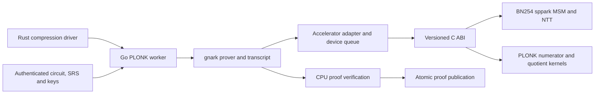

# BLS12-381 PLONK wrapper plan

> Historical design and measurement record. Current BN254 build/run instructions
> are in [the helper guide](../tools/plonk-wrapper/README.md). BLS commands and
> artifacts below describe the implementation preserved on `sb/bn254-bls-preserved`.

Implementation state and measured results as of 2026-10-16 are recorded in the
[implementation handoff](plonk-wrapper-status.md). Full BLS parameter
preparation and native proving/verification have completed on the actual Init
packet. The wrapper remains experimental. The sequence below describes its
validation and acceptance criteria; the status document distinguishes measured
results from pending integration work.

The optional BN254 backend has a separate
[wrapper implementation plan and ceremony research](compression-architecture-options.md#bn254-gnark-wrapper-implementation-plan).

Add a terminal KZG-PLONK proof over the BLS12-381 scalar field around ix's
existing final KZG packet. The wrapper must enforce the complete inner
verification relation, including both pairing obligations. Its recipient checks
only the PLONK proof and the independently expected claim digest.

The priority is cheap verification, including Solidity verification. Reuse the
existing Filecoin Powers of Tau and accept the additional prover work needed to
put the inner pairing checks inside the circuit. No circuit-specific trusted
ceremony is acceptable. PLONK circuit compilation and deterministic key
generation from public parameters are acceptable.

Switch the final ix KZG transcript from Keccak back to BLAKE3 and add the
terminal PLONK stage. Reuse ix's existing BLAKE3 transcript definition and
recursive-verifier vectors. Regenerate the final verifying key, packet fixtures and
wrapper keys together; an existing Keccak packet cannot be converted by changing
its identifier. Backward compatibility with the Keccak verifying key is not required.
The earlier compression stages and Filecoin parameter ownership remain intact.

Implementation baseline: ix `sb/solidity-verifier` at
`faba9bdd4445295f08dfbcf773ada80afe3f0c35`, the exporter commit immediately after
`sb/proof-compression` at `eb50b1b2e08e6f4d5926617fd0773d2a7c8eeb8d`.
It retains multi-stark `8b6c3fbdd8575bfeb818a32acf06509bac81ff3b` and the existing
Filecoin setup implementation. Source links pin this baseline. Refresh the
exported verifying key and fixtures together if the inner protocol changes.

## Existing ix components to reuse

Filecoin provisioning and setup policy are already implemented. This work needs
a PLONK representation adapter, not another downloader, ceremony importer, or
independent Filecoin authentication implementation.

| Existing component | Role in the wrapper |
| --- | --- |
| [SetupConfig and SetupSource][ix-setup] | Reuse environment selection, explicit development policy, authenticated SRS loading, and verifier parameters. |
| [Filecoin loader][ix-filecoin] | Reuse receipt and chunk authentication, pinned anchors, validated point decoding, and the provisioned prefix cache. |
| [Srs and PublicSetup][ix-srs] | Preserve the ceremony identity and complete public degree independently of the loaded prefix. |
| [Bundled verifier catalog][ix-catalog] | Select and authenticate the inner verifying key and its aggregation-program prefix. |
| [Recursive packet verifier][ix-verification] | Use as the native acceptance oracle, including the separate deferred pairing equation. |
| [Statement encoding][ix-statement] and [compact proof codec][ix-codec] | Derive canonical packet shape and claim binding from the trusted verifying key. |
| [Solidity exporter][ix-exporter] and [opening code generator][ix-opening-export] | Share validated graph instructions, matrix layout, opening formulas and differential vectors with the gnark circuit. |
| [Recursive verifier gadgets][ix-recursive] | Reuse constraint descriptions, test vectors, and scalar/MSM verification logic where applicable. |
| [Fixed preprocessing cache][ix-cache] and [storage helpers][ix-storage] | Reuse cache identity principles, checksums, and durable publication helpers. |

The existing recursive gadget accepts BLAKE3 and exposes pairing operands for
external verification. It supplies a tested specification for the wrapper's
transcript, scalar checks and MSMs. The gnark circuit must additionally enforce
the resulting pairing equation and the separate deferred pairing equation.

## Proof relation and public inputs

Pin the inner verifying key, its constraints and fixed commitments, Filecoin
anchors, domain sizes, transcript parameters, and aggregation-program prefix in
the wrapper circuit. A proof cannot supply its own trusted verification key or
constraint graph.

The private witness is the existing final packet, or an equivalent decoded
representation whose canonical encodings are constrained. The current fixture
is 2,181 bytes and contains 15 outer-proof G1 points, 37 scalar values, two
deferred G1 pairing operands, the statement, and the verifying key identifier. Derive
dimensions from the trusted codec when exporting a verifying key rather than treating
these fixture counts as a general protocol rule.

Expose the existing 32-byte claim digest as two public 128-bit limbs. For digest
bytes `d[0..32]`, define each limb by little-endian packing of its consecutive
16-byte half. Constrain the limbs to 128 bits and reconstruct the eight
little-endian 32-bit words in statement positions 10 through 17. Statement
positions 0 through 9 are constants from the authenticated verifying key.

This preserves ix's existing BLAKE3 claim digest without adding a new hash of the
statement. Native callers compute the expected digest through the existing ix
claim encoding. A Solidity caller supplies an independently expected digest,
which the application binds to its own statement or state. The contract derives
the two public limbs from that digest; it does not trust a digest embedded in
the proof.

The circuit must enforce all of the following:

1. Exact verifying key and shape, canonical scalar and point encodings, and the public
   statement binding.
2. The existing BLAKE3 transcript, including parameter seeding, observation
   order, lengths, canonical encodings, challenge reduction and opening
   omissions. Each squeeze hashes the old 32-byte state followed by the
   observations, uses the first 64 XOF bytes as a little-endian integer reduced
   modulo Fr, and takes the next 32 bytes as the new state.
3. Public-message balance, lookup relations, quotient reconstruction, and the
   out-of-domain constraint identities, including invalid-challenge rejection.
4. The KZG opening MSMs and their resulting pairing equation.
5. The deferred pairing equation carried by the recursive packet, with its
   operands bound to the same inner proof's public values.

Keep two separate pairing equations as the reference implementation and size
randomized batching in step 2. The [batching requirements below](#randomized-pairing-batching)
apply to both the BLS12-381/Filecoin and BN254/Ignition wrappers. Adoption
requires a reviewed transcript specification, adversarial tests and a measured
net constraint saving.

Every untrusted G1 point must receive the required canonical, curve, and subgroup
checks. Constrain ix's infinity flag and canonical compressed identity encoding
to map to gnark's affine `(0,0)`, and require finite points to satisfy their
curve equation. In gnark v0.16.4, `ScalarMul` and `MultiScalarMul` use complete
arithmetic by default; preserve that default and use `AddUnified` for explicit
additions. Do not enable `WithIncompleteArithmetic` on these proof paths.
Exercise zero scalars, infinity, equal/opposite points and identity sums.
Trusted SRS anchors must remain nonidentity. Precomputed G2
line coefficients can be circuit constants derived from the pinned anchors;
prover-supplied unconstrained line coefficients are not acceptable.

Host parsing and native verification provide diagnostics and differential
oracles. They cannot substitute for constraints: negative tests must construct
adversarial circuit witnesses that bypass the normal host preparation path.

### Randomized pairing batching

Randomized KZG opening aggregation has concrete precedents, inspected on
2026-10-16:

| Implementation | Observed batching |
| --- | --- |
| [SP1 v6.1.0 PLONK verifier][sp1-pairing-batch] | `batch_verify_multi_points` hashes opening commitments, opening proofs and preceding challenges, folds two KZG openings, and checks one two-term pairing product. |
| [Ethereum C-KZG][ethereum-kzg-batch] | Hashes a domain separator, commitments, evaluation points, evaluations and proofs; weights openings by challenge powers and performs one two-term pairing check. |
| [ZisK FFLONK prover][zisk-fflonk-challenge] | Samples `alpha` after absorbing evaluations and [combines opening quotients with weights `1, alpha, alpha²`][zisk-fflonk-batch]. |

These establish precedent for the algebraic technique. They do not establish
soundness of ix's exact circuit integration. In particular, the ZisK evidence
concerns polynomial-opening aggregation, not merging ix's two independent
pairing obligations inside gnark. The separately researched PILFFLONK PR 610
was still open and unmerged at the inspection date; it is not deployment
evidence for that optimization.

#### Equation and soundness argument

Let `r` be the prime subgroup order. With identical ordered G2 anchors, the
existing checks are:

```text
E0 = e(L, H) * e(-R, tauH) = 1
E1 = e(A, H) * e(B, tauH)  = 1
```

For a fresh scalar `rho`, bilinearity permits checking:

```text
e(L + rho*A, H) * e(-R + rho*B, tauH) = E0 * E1^rho = 1
```

Write the residuals as `E0 = g^a` and `E1 = g^b` in the prime-order target
group. Acceptance requires `a + rho*b = 0`. For fixed operands with at least
one invalid equation, at most one scalar satisfies this relation. A uniformly
sampled nonzero challenge therefore contributes error at most `1/(r-1)`.

Under the classical random-oracle model, `Q` adaptive hash/grinding attempts
give an additional error bound of approximately `(Q+1)/(r-1)`, before accounting
for the actual sampling bias and hash security. This batching error is separate
from the assumptions and security level of the curves and proof systems. The
argument requires the operands to be fixed before the fresh challenge; it does
not apply to operands that already depend on that challenge.

#### Required transcript and circuit checks

1. Derive `rho` inside the circuit after computing and constraining `L`, `R`,
   `A` and `B`. Bind their canonical encodings, a distinct batching
   protocol/curve/version domain, the trusted inner verifying key and
   setup/basis identity, and the expected statement/claim. Bind the canonical
   packet as well, either directly or through an explicitly specified,
   circuit-constrained transcript digest that commits to it. Host-supplied
   unconstrained bytes or challenges cannot establish this binding.
2. Use a new BLAKE3 challenge. Do not reuse `challenges[5]`: the current scalar
   program uses it to derive both opening MSMs. Its left coefficients depend
   on challenges 3, 4 and 5; its right coefficients depend on challenge 5.
   Hashing the resulting outer PLONK verifying key as a circuit constant would
   be circular. The batching context binds the inner verifying key; the outer
   PLONK protocol provides its own verifying-key binding.
3. Specify the exact encoding, hash-to-field reduction and zero-challenge
   rule. Reject zero in-circuit or define constrained resampling. Mapping zero
   to one changes the challenge distribution and must change the bound. The
   existing 512-bit XOF reduction is a possible starting point, with its
   modulo bias included in the analysis.
4. Check equality of both ordered G2 anchors before selecting this two-term
   fold. The actual Ignition input has matching anchors, but general BN254
   verifying-key validation permits different inner and outer keys. Retain
   separate checks or reject the batching configuration when they differ.
5. Preserve canonical encoding, curve/subgroup membership, trusted nonidentity
   G2 anchors, and complete G1 arithmetic including infinity. The computed
   operands must remain constrained to the original MSMs and deferred public
   values. A shared multi-pairing call without a fresh random coefficient does
   not enforce the two equations independently.

#### Acceptance tests and cost gate

Keep the separate checks as the differential reference. Test valid inputs,
each equation invalid independently, and two invalid equations deliberately
constructed to cancel under a predetermined coefficient. Use valid canonical
subgroup points so decoding failures cannot masquerade as batching soundness.

A cancellation fixture can use public points `C,T` satisfying
`e(T,H) = e(C,tauH)`, such as consecutive SRS powers. Choose nonzero `rho0`
and points `P,Q` for which `e(P,H)e(Q,tauH) != 1`, then set:

```text
A = P                    B = Q
L = T - rho0*P           R = C + rho0*Q
```

Both original equations fail, while the combined equation at `rho0` reduces
to the valid relation `e(T,H)e(-C,tauH) = 1`. The fresh transcript-derived
challenge must reject this fixture; check that its challenge differs from
`rho0`. Also mutate every bound operand and context field, exercise the chosen
zero-challenge rule, and cover infinity, negation and identity sums. Preserve
the existing valid-outer/invalid-deferred witness test and bypass native
pre-verification in the adversarial circuit tests.

Measure the whole circuit with both variants, including the extra BLAKE3 work,
point encoding, scalar multiplications and additions. Establish the BN254
component breakdown independently of the historical BLS measurements. The
optimization is a proposal until its transcript, quantitative soundness
argument, adversarial coverage and net constraint saving have been reviewed.

#### Measured BN254 candidates

The actual Init verifying key was compiled with the pinned gnark revision on
2026-10-16. The baseline separate-pairing circuit has 17,996,083 rows including
its two public inputs. Randomized batching reduces that to 17,530,148, still
752,932 above `2^24`. Selecting gnark's complete classic-GLV multiplication
path instead gives 14,689,442 rows with separate pairings, or 13,810,186 with
batching. The normal helper selects classic GLV and separate pairings; the
batching implementation is retained as an internal measurement variant.
See the [component and correctness results](plonk-wrapper-status.md#bn254-pairing-batching-and-reduction-to-224).

The experimental BN254 batching input is the concatenation of:

1. ASCII `ix/plonk/pairing-batch/bn254/v1` followed by one zero byte.
2. The 32-byte BLAKE3 digest of `json.Marshal` on the validated Go `verifying key`
   struct. Struct field order and string spellings are preserved. This is a
   circuit constant committing to the inner verifying key, setup identity, G1 basis
   anchor, ordered G2 anchors, scalar program, seed and fixed statement prefix.
3. The two public claim limbs, each encoded as 16 little-endian bytes.
4. The final 32-byte state from replaying the inner transcript: XOF bytes
   64 through 95 from the sixth squeeze. It transitively commits to every
   packet scalar and point, including the deferred operands and final opening
   witnesses. The state is computed in-circuit, not provided as an independent
   witness.
5. Canonical ix compressed encodings of `L`, `R`, `A`, `B`, in that order,
   32 bytes each. Computed `L` and `R` coordinates are strictly reduced before
   encoding; existing input canonicality and curve checks are retained.

The first 64 BLAKE3 XOF bytes of this input are interpreted as a 512-bit
little-endian integer and reduced modulo BN254 Fr. The circuit rejects zero.
It then constrains `L + rho*A` and `-R + rho*B` with complete G1 arithmetic
and checks the single two-term pairing product against the matching anchors.

For a fixed nonzero target scalar, this reduction assigns probability at most
`ceil(2^512/r)/2^512 <= 1/r + 2^-512`. Rejecting zero does not increase the
unconditional probability of an invalid fixed pair of equations passing one
attempt. In the classical random-oracle model, `(Q+1)*(1/r + 2^-512)` bounds
the additional cancellation probability across `Q` adaptive queries plus a
final attempt, subject to the operand/context binding assumptions above.
The 256-bit transcript states and hash security, and the underlying curve
and proof-system assumptions, remain separate limits on overall security.
This analysis is not a claim that BN254 provides 254-bit security.

Tests cover native/circuit challenge agreement, all four operand bindings,
both claim limbs, transcript state, context changes, zero and multiple-of-Fr
rejection, matching anchors, identity cases, individually invalid equations,
and deliberately cancelling equations at a predetermined coefficient. The
real Init witness also passes the batched circuit while claim, evaluation,
commitment and deferred-operand mutations fail. No full batched PLONK proof
or production verifier key has been generated.

## Backend and integration

Use a separately versioned Go helper based on current upstream gnark. As of
2026-10-15, the latest release is [v0.16.4][gnark-release] and the inspected
default-branch tip is `262cf453c107d147a228b6b7418c5cf791c3b79b`. Pin that tip
as the implementation candidate, including its dependency graph and Go 1.26.8
toolchain requirement. Its post-release changes include a SHA3 `Sum` state fix,
an SCS zero-coefficient fix and lookup-argument improvements. Recompile and size
against that exact revision. The BLS12-381 PLONK backend and curve gadgets used
for the cost table are unchanged from v0.16.4.

Place the Go module under `tools/plonk-wrapper/` and add a narrow Rust adapter
under `crates/proof-compression/src/plonk/`. Rust owns verifying key selection,
Filecoin parameter loading, packet decoding, and integration with the existing
worker. The helper owns circuit compilation, PLONK indexing, proving, native
wrapper verification, and Solidity export.

Use a versioned canonical interchange format for the trusted verifying key, witness,
and SRS adapter output. Specify lengths, endianness, field bounds, infinity
encoding, and artifact digests. Never exchange an arkworks or gnark in-memory
Montgomery representation as the transport format.

Scalar identities of the existing proof are native over BLS12-381 Fr, but the
generic curve API takes scalars as `emulated.Element[Fr]`. Build those limbs from
a constrained canonical bit decomposition of each native scalar, enforce the
integer bound below Fr, and reuse the decomposition. Equality modulo the native
field alone does not establish a unique encoding. Count this conversion and
its range checks separately. G1 and pairing arithmetic use the larger Fq field
and remain emulated.

Use `PairingCheck`, which constrains a non-residue witness instead of computing
a full final exponentiation. It does not establish the G1 input subgroup
obligations. Supply trusted constant G2 lines and validate all variable inputs.
Pass the 19 pinned commitments and generator as compile-time constants so
gnark's fixed-base comb tables apply; ordinary variable-base MSM estimates
overstate this portion of the circuit.

Distinguish the final ix KZG transcript, which is replayed inside the circuit,
from the outer PLONK transcript, which native and Solidity verifiers replay.
Use gnark's matching native/Solidity configuration for the latter. Freeze both
choices in the wrapper verifying key and test their encodings independently.

### SP1 comparison and GPU support

The architecture matches SP1's terminal PLONK path: Rust prepares a recursive
verifier circuit and witness, Go/gnark compiles an SCS, deterministic PLONK
indexing uses a universal monomial/Lagrange SRS, and the resulting key exports a
Solidity verifier. At SP1 `02fa30185ecd658174b211d56128b14867ab8e81`, that path
uses BN254 and Aztec Ignition parameters. Its [Go dependency][sp1-go-mod] is a
gnark v0.14-era fork at `p4u/gnark` commit `cd7874155e26`, not current upstream.
Its [build][sp1-build] and [prove][sp1-prove] code are integration references,
not a source for this wrapper's circuit costs: SP1 wraps its recursive STARK
verifier, whereas ix also needs emulated BLS KZG MSMs and pairing checks.

The GPU source review was refreshed on 2026-10-16. Support differs by proof
system, curve and runtime:

| Path | Current support and consequence |
| --- | --- |
| Native gnark PLONK helper | CPU when no accelerator is attached. The selected `2^24` Init wrapper has a full verified proof: 53.785 seconds core proving and 73.704 seconds for the fresh process, with prepared keys. |
| [gnark WebGPU backend][gnark-webgpu] | Experimental BN254, BLS12-377 and BLS12-381 PLONK acceleration. It offloads MSMs, FFT work and the quotient numerator, and builds only for `GOOS=js GOARCH=wasm` with a JavaScript/WebGPU runtime. It is not enabled by the native Go helper. |
| [gnark ICICLE/CUDA integration][gnark-icicle] | The packaged integration supports Groth16, not PLONK. SP1's [CUDA feature][sp1-cuda] selects that Groth16 path; its inspected final PLONK prover calls the CPU backend. Earlier SP1 proving stages can use GPUs independently. |
| [Polytope Labs gnark-cuda][polytope-cuda] | Native CUDA BLS12-381 PLONK, including device-resident quotient evaluation, MSMs and FFTs. It requires a curve port and integration work for this BN254 wrapper. |

Polytope reports about 13.5 seconds on an RTX 5090 for a 7,097,608-constraint
BLS12-381 circuit, versus about 98 seconds on CPU. Its CUDA configuration
targets SM120, the same compute capability as this host's RTX PRO 6000
Blackwell GPUs. These are the project's measurements on another circuit and
curve, not a speedup estimate for ix. Its active integration uses an older
gnark fork and BLS-specific field constants and point layouts. The inspected
shim revision has no explicit repository license; clarify reuse permissions
before vendoring its code. Its [documented MSM issue][polytope-msm-bug] also
requires attention: Montgomery inputs can produce incorrect results when the
underlying ICICLE MSM chunks under memory pressure, and the shim converts to
canonical inputs as a workaround. A root fix was not established by this review.

No turnkey native CUDA BN254 PLONK backend compatible with the current helper
was identified. A native adapter on the existing gnark version is nevertheless
a concrete implementation path.

#### BN254 PLONK CUDA design

This is the implementation design for the selected **classic-GLV, separate-pairing
BN254 wrapper**. As of 2026-10-17, the optional native CUDA adapter, MSM/FFT hooks,
unfused numerator and fused quotient are implemented. Complete CPU, unfused CUDA
and fused CUDA Init proofs have passed independent CPU verification under the
same verifying key. The first CUDA proof exposed a severe structured-witness MSM
bottleneck; the bounded-bucket implementation and its measurements are recorded
in the [implementation status](plonk-wrapper-status.md). Warm services,
cross-process GPU admission and further device residency remain planned work.
The initial adapter serializes synchronous calls with a mutex and locks the
calling goroutine to an OS thread for each native operation. The persistent
worker queue, shared device lease and cancellation protocol described below
are service targets, not properties of the current helper.

The completed split-bucket benchmark reaches **11.352 s median core proving**,
against a matched **53.895 s CPU median**, with native and Solidity verification.
The [remaining-bottleneck profile](plonk-wrapper-status.md#remaining-bottleneck-measured-cpu-stages-and-transfers)
attributes a subsequent 11.500 s proof to 2.991 s initialization, 1.650 s solving,
1.686 s permutation work and substantial CPU opening/linearization work. Actual
DMA totals 0.460 s; 0.778 s of host staging overlaps device work. Prioritize
immutable trace/domain reuse, fixed-support/canonical-Qk reuse and evaluation
scheduling before larger permutation/opening offload. Preserve private mutable
proof state; existing canonical conversion mutates trace polynomials in place.
The quotient remains on the critical path. L/R/O/Qcp evaluations overlap Z
opening and currently add no separate critical-path delay.

##### Baseline and decisions

| Property | Design baseline |
| --- | --- |
| Constraints / public inputs | 14,689,440 / 2 |
| Total rows / padded domain | 14,689,442 / `N = 2^24 = 16,777,216` |
| Headroom | 2,087,774 rows |
| Quotient evaluation domain | `M = 4N = 2^26` |
| Additional BSB22 commitments | 1 |
| Inner relation | Classic GLV, canonical encodings, both pairing checks retained |
| Parameters | Admitted Ignition shifted basis; `N+3` monomial and `N` Lagrange points |
| Initial hardware | One RTX PRO 6000 Blackwell, SM120, approximately 96 GiB VRAM; host has 499 GiB RAM and 48 logical CPUs |
| Scale-out | One independent worker/proof per GPU; two GPUs are not a shared memory pool |

The [full CPU reference](plonk-wrapper-status.md#bn254-224-full-init-proof-benchmark)
is recorded in `target/bn254-plonk-2p24/report.json`, with circuit SHA-256
`a684964f61296fcda0df427980275764df242590373ce5680f70b0ac5dcfbded` and
verifying-key SHA-256
`4f27f4cb17c22d0e73de231ffbda679314c76a2103f24468af5c700b599ff368`.
The full proof, independent native/Rust verification and negative checks passed.
Core proving took **53.785 seconds**, the fresh process **73.704 seconds**, peak
RSS **25.19 GiB**, and in-memory verification **1.488 ms**. Native/enveloped
proof sizes remain 584/624 bytes. These are one prepared-key proof sample on
48 logical CPUs with uncontrolled OS page-cache state; repeat and verifying key this
configuration before projecting GPU gains. The historical 104.33-second core
result belongs to the old `2^25` circuit.

The `2^24` Lagrange basis and keys are now cached. One-time preparation took
358.302 seconds, including 325.258 seconds for conversion/cache publication and
12.542 seconds for indexing. Preparation is excluded from the proof baseline.

##### Measured inputs to the CUDA design

The focused CPU profiling run reused authenticated circuit/keys/witness in one
process, with one warmup and three measured proofs. All four proofs independently
verified with the frozen CPU helper and the pinned verifying key. The two
unprofiled warm runs took **53.667 and 53.696 seconds** (median 53.681); the
profiled run took 53.703 seconds. Artifact validation took 1.025 seconds,
circuit decoding 0.808 seconds and proving-key decoding 20.325 seconds. Retaining
the helper avoids that repeated loading. The four-proof process peaked at
34.89 GiB RSS, compared with 25.19 GiB for the earlier fresh process; this short
run does not establish long-term heap stability.

Exclusive classification of sampled stacks gives the following CPU-work split:

| Arithmetic family | Share of sampled CPU time |
| --- | ---: |
| FFT/NTT | 45.99% |
| MSM/G1 arithmetic and scalar partitioning | 42.30% |
| Numerator pointwise arithmetic, scaling and restoration, excluding FFT | 9.33% |
| Opening/evaluation/linearization, excluding MSM and FFT | 1.05% |
| Permutation accumulation | 0.66% |
| Remaining visible solver, trace, division and runtime work | 0.67% |

These are aggregate thread CPU samples, **not wall-clock stage percentages**.
Most FFT/MSM worker stacks omit the launching phase, so the verifying key does not
separate L/R/O from H commitments or N-sized from M-sized transforms. It supports
accelerating MSMs and the complete numerator/FFT path together; stage spans are
still required for a critical-path speedup estimate. Evidence is in
`target/bn254-plonk-2p24/cpu-profile-report.json` and
`target/bn254-plonk-2p24/cpu-profile-analysis/families.json`.

The existing ix CUDA primitives were measured on GPU 0 with dense seeded Fr
vectors, admitted Ignition points, full Arkworks CPU comparisons and default CPU
parallelism. Six separate processes covered cached/uncached MSM and forward/
inverse coset FFTs at N and M. Every output matched its CPU reference; the four
MSM cases and four FFT cases each had a first call plus three warm repeats:

| Primitive | Warm median | Warm range |
| --- | ---: | ---: |
| Cached MSM, N points | 72.67 ms | 72.65–72.94 ms |
| Cached MSM, N+3 points | 74.15 ms | 73.37–74.27 ms |
| Uncached MSM, N points | 114.87 ms | 114.61–114.95 ms |
| Uncached MSM, N+3 points | 121.02 ms | 119.42–122.00 ms |
| N-point forward coset FFT | 39.85 ms | 38.81–39.93 ms |
| N-point inverse coset FFT | 40.38 ms | 39.13–41.45 ms |
| M-point forward coset FFT | 155.37 ms | 154.30–156.54 ms |
| M-point inverse coset FFT | 157.94 ms | 154.72–158.72 ms |

GPU call timings include native host transfers; input generation, external
host copies, hashing and CPU comparisons are separately recorded. Cached MSM
excludes its one-time point upload/workspace initialization (120.77 ms for the
first basis, after 323.45 ms device initialization); uncached MSM includes
upload and destruction. N+3 uses one exact N-point GPU MSM plus three CPU points
and addition. Its source slice starts at point 7, but the uploaded native cache
starts at offset zero: this does not establish native cached-offset coverage.
The FFTs use shift 5 and regular host ordering. First FFT calls took 109–111 ms
at N and 225–227 ms at M; these include first-transform initialization.

The CPU references use Arkworks rather than gnark, so their component ratios
are not a gnark speedup benchmark. These measurements establish arithmetic
feasibility at the required sizes; the gnark adapter, its polynomial layouts,
fused quotient and a complete GPU PLONK proof remain implementation work.
Reports and the frozen test-binary identity are in
`target/bn254-plonk-2p24/cuda-primitives-summary.json`; raw results and resource
records are under `target/bn254-plonk-2p24/cuda-primitives/`.

Two representative cases were repeated with CUDA allocation-pool counters,
again passing every full CPU comparison. Cached N-point MSM reached **1.877 GiB
pool usage / 1.906 GiB reservation**; the M-point inverse FFT reached **2.020 GiB
usage / 2.031 GiB reservation**. These are process-local pool high-water marks,
not complete VRAM peaks: driver/context/module allocations outside the pool
are excluded. Two-second NVML sampling missed the short allocation peaks and
must not be used as a full-size memory bound. Reports are under
`target/bn254-plonk-2p24/cuda-memory/`. These primitive measurements are separate
from the complete PLONK memory measurements in the implementation status; the
conservative planning ledger below is not a measured peak.

##### Implementation decisions

Keep gnark `262cf453c107d147a228b6b7418c5cf791c3b79b` and its pinned gnark-crypto
version. Use a narrowly patched, pinned gnark fork for dispatch extensions;
change its generator templates and generated BN254 code together. Never edit
module caches or research clones. Reuse ix's pinned sppark source
`114feb69ebfe029e2caa5e6c2d372c695e5d4da8` for BN254 field arithmetic, MSMs and
NTTs. The Apache-licensed gnark CPU/WebGPU implementations define the PLONK
arithmetic contract. Polytope's implementation is a feasibility reference;
vendoring its unlicensed shim or downgrading gnark is not part of this design.

Go retains constraint solving, cryptographic randomness, Fiat–Shamir and BSB22
hash-to-field, public-input binding, opening aggregation, proof serialization
and verification. CUDA accelerates arithmetic under those protocols. Preserve
the circuit, proof encoding, Solidity transcript options and verifying key.
The first production target includes fused numerator evaluation, quotient
division and inverse FFT. More extensive polynomial residency is a separately
versioned extension after profiling.

##### Architecture and source ownership



| Location | Responsibility |
| --- | --- |
| `tools/plonk-wrapper/backend_cuda_bn254.go` | Runtime backend selection, attach/detach and proof-session lifecycle; `bn254 && cuda` build tags |
| `tools/plonk-wrapper/backend_cpu.go` and CPU stubs | Pure-Go default; clear rejection of an unavailable requested backend |
| `tools/plonk-wrapper/internal/cuda/` | cgo ABI, validated key ranges, device queue, contexts, telemetry and typed polynomial descriptors |
| `crates/proof-compression/cuda/plonk/` | Dedicated `ix_plonk_bn254_cuda` library: public C header, context/planner, MSM/NTT adapters, numerator, division/scatter and error handling |
| Shared headers under `crates/proof-compression/cuda/` | Extracted field, transfer and arithmetic helpers shared with the existing KZG backend; preserve its public ABI |
| gnark fork generator / `backend/plonk/bn254` | Immutable operation capabilities and explicit fused-quotient dispatch |
| `flake.nix`, `lakefile.lean` | Optional native-library build, dependency hashing and runtime packaging |
| `tests/` and helper tests | Differential vectors, end-to-end proof checks, resource and benchmark runners |

Build the native library from named source inputs with a documented include root
for the pinned sppark tree. Do not link an arbitrary archive discovered in a
Cargo build directory. Export only `ix_plonk_bn254_*` C symbols, use hidden C++
visibility, and catch every C++ exception at the boundary. This library has no
Goldilocks or generic multi-stark quotient dependency.

##### Gnark integration contracts

The existing [Accelerator interface][gnark-plonk-accelerator] is retained:

```go
MultiExp(bases []G1Affine, scalars []fr.Element) (G1Affine, error)
ToCanonical(domain *fft.Domain, p *iop.Polynomial) error
ComputeNumerator(in *NumeratorInput) (*iop.Polynomial, error)
```

Add an optional `AcceleratorFeaturesV1` interface returning immutable feature
bits for MSM, canonical conversion, numerator evaluation and fused quotient
computation. Existing accelerators that do not implement it retain their original
three-operation behavior, with fused quotient disabled. Validate and freeze
capabilities before `Prove` starts. At the existing dispatch sites, a disabled
feature invokes gnark's original CPU implementation.
This permits an MSM-only pilot without copying the unexported CPU numerator.
The capability decision precedes any buffer mutation; CUDA allocation/runtime
errors are fatal to that proof and never trigger a silent CPU retry.

The initial adapter honors all current contracts:

- `MultiExp` accepts subslices of the strongly held monomial or Lagrange SRS and
  returns the same affine result as native arithmetic.
- `ToCanonical` mutates host coefficients to canonical basis, regular order,
  including inverse normalization and inverse coset scaling. Under the current
  hooks it covers the final large-domain inverse FFT, not the size-N transforms
  called directly inside CPU numerator construction.
- `ComputeNumerator` returns actual numerator evaluations in
  `LagrangeCoset/BitReverse` form on M. All nonblinding input polynomials must
  contain canonical coefficients in regular order on return; blinding
  polynomials remain unchanged. Cache fixed canonical coefficients, canonicalize
  dynamic inputs once, and sweep the four cosets from those coefficients.

For the production fused path, add a separate optional interface:

```go
type QuotientAcceleratorV1 interface {
    ComputeQuotientV1(*NumeratorInput) (*iop.Polynomial, error)
}
```

Its output is the actual **canonical/regular quotient H**, of length M, with
exactly the same input-restoration guarantee. `computeQuotient` skips
`divideByZH` when this interface is selected. Enabling the feature requires the
method; implementing the method alone does not enable it. This allows the same
adapter type to run unfused comparison modes. Never return H through
`ComputeNumerator` while labelling it as numerator evaluations. The standard
host shard construction still applies gnark's quotient randomizers and `N+2`
split convention.

At N=`2^24`, the unfused numerator/division/IFFT boundary transfers its 2-GiB
result three times: device-to-host, host-to-device, device-to-host. Fusion
reduces those approximately 6 GiB to one 2-GiB download. Canonical-input
restoration transfers are additional and must be measured separately.

##### Proof schedule and transcript barriers

The existing goroutines retain their mathematical dependencies:

| Phase | CPU responsibility | CUDA work and readiness condition |
| --- | --- | --- |
| Load/prewarm | Authenticate artifacts, load CS/PK and domains; derive immutable static coefficients | Upload both bases; cache canonical static coefficients and plans |
| Solve witness | Solve constraints and evaluate hints; sample existing blinding randomness | The BSB22 commitment hint may invoke MSM before solving finishes |
| Commit L/R/O | Preserve padding corrections, public-input binding and existing commitment order | MSMs return completed points before gnark samples gamma/beta |
| Build Z | Existing permutation accumulation and Z blinding | Commit Z; return before alpha is derived |
| Numerator/quotient | Complete Qk with public values and BSB22 hash injections; supply alpha/beta/gamma | Four coset sweeps, numerator evaluation, division and M-IFFT |
| Commit H shards | Existing shard splitting and statistical-ZK randomizers | Three MSMs finish before zeta is derived |
| Open/linearize | Existing evaluation, linearization, KZG folding and opening division | MSMs for the linearized polynomial and two opening proofs |
| Finish | Serialize and verify with the CPU verifier and expected claim | Drain job resources before publication |

The current one-commitment shape routes eleven large MSMs through the hooks;
eight tiny blinding MSMs stay on CPU. L/R/O MSM lengths are 14,689,442,
14,689,440 and 14,689,440; Z and BSB22 use N. These are structural counts, not
performance predictions. Preserve `chH`'s guarantee that quotient commitments,
zeta derivation and restoration of canonical polynomials have completed.

No GPU callback chooses transcript challenges or substitutes a host-only hint
for a circuit constraint. Device operations return their mathematical outputs
before the existing Go transcript observes them.

##### MSM implementation

Cache monomial `[0,N)` and Lagrange `[0,N)` on device. Keep the final three
monomial points available to the CPU tail path. Existing cached sppark MSM
calls accept at most `2^24` points; `N+1`, `N+2` and `N+3` commitments therefore
split at the cached range boundary and add the at-most-three-point CPU result.
Do not round `N+3` up to `2^25` or pass it to an unsupported native call.

Resolve every request as `(key owner, basis, offset, count)`, validate bounds,
and handle nonzero-offset slices and range-crossing tails. A raw host address
alone is not a cache identity. Small/empty requests have explicit tested CPU
semantics and are reported as such; they are not an error fallback. Preserve
padding corrections using `pk.Kzg.G1[0]`, which is Ignition's shifted base,
not the canonical curve generator.

Use the native planner for the actual count/window class. Workspaces are leased
exclusively and must match that class; do not reuse a full-domain workspace for
an incompatible small MSM. Return a checked projective result through the ABI
and normalize with gnark's native field implementation, including infinity.
Test host/resident scalar sources, offsets, zero coefficients, cancellation,
chunk boundaries and short tails before admitting the full circuit.

Real gnark witnesses require balanced bucket work even when whole scalar
values are distinct: small integers, powers of two and shifted witness values
can share digits in individual Pippenger windows. The default strategy splits
large buckets while preserving dropped zero digits and sppark's parallel ±1
path for window zero. The pinned `breakdown` already applies `s.abs()` and
propagates its sign into every nonzero Booth digit; small negative scalars
therefore already fold into small positive magnitudes.

Apply a narrowly pinned sppark patch to a private build copy. Each ordinary
bucket accumulates its first at most 256 points, with excess points described
by additional tasks of at most 256 points. Parallel workers accumulate the
partial sums; a 256-lane block reduces each heavy bucket's partials before the
unchanged integration step. Bound both accumulation and reduction: with the
supported `2^24` input cap, each reduction lane handles at most 256 partials.
Preserve batch-relative indices, digit signs and top-window placement. Account
for descriptors, partials, ranges and queue counters before launch; detect
overflow before publishing outputs. Scratch planning must use the same raw
count for batch/stride computation as `invoke`, while window selection uses
the rounded count.

Keep an explicitly selected masking strategy for comparison, using the exact
identity `MSM(s+r) - MSM(r) = MSM(s)`. Generate reproducible broad-digit masks
on device and cache the correction point by immutable basis/range; use complete
point addition for cancellation and infinity. Masks serve arithmetic scheduling,
not protocol randomness. This path makes sparse scalars dense and needs a cold
correction MSM, so it is not the default. Neither strategy applies the earlier
whole-scalar affine normalization; combining it with masking adds work without
retaining its fast-digit benefit.

Capture actual Init commitment vectors in an opt-in CPU test, recording their
authenticated basis ranges, raw-scalar hashes and exact CPU results. Replay
them through the candidate GPU backend before repeating full proofs. Report
per-window nonzero/zero digit counts, maximum regular-bucket length, split work
items, scratch and phase timings. Test 255/256/257 and reduction boundaries,
signed/high-window concentrations, mixed dense exceptions, cancellation and
infinity against full CPU references. Batch L/R/O, further polynomial residency,
workspace reuse and window sweeps remain subsequent measured optimizations.

##### NTT and quotient kernels

Use explicit descriptors for field, count, basis, order, coset and normalization.
Check that the chosen roots satisfy `Omega^4 = omega`, and that the coset
multiplier equals gnark's domain/verifying-key constant. Reuse sppark's NTT,
with explicit adapters for regular and bit-reversed layouts. The production
transforms are size N and M=`4N`; bound all byte-count arithmetic with checked
64-bit operations. Tiny fixtures using an 8N domain require a separately
supported capability or predeclared CPU execution.

Let `u` be `Domain1.FrMultiplicativeGen`, `s_i = u*Omega^i` and
`x = s_i*omega^j`, for coset `i in [0,4)` and row `j in [0,N)`. Define
`ZH(x)=x^N-1`. For `p` in L/R/O/Z, use gnark's blinding polynomials:

```text
p_tilde(x) = p(x) + ZH(x) * b_p(x)
Z_tilde(omega*x) = Z(omega*x) + ZH(x) * b_Z(omega*x)

A(x) = Ql*L_tilde + Qr*R_tilde + Qm*L_tilde*R_tilde
     + Qo*O_tilde + Qk_complete + sum_i(Qcp_i*Pi_i)

B(x) = Z_tilde(omega*x) * product_j=0..2(W_tilde_j + beta*S_(j+1) + gamma)
     - Z_tilde(x)       * product_j=0..2(W_tilde_j + beta*u^j*x + gamma)

C(x) = (Z_tilde(x)-1) * (x^N-1) / (N*(x-1))
Numerator(x) = A(x) + alpha*B(x) + alpha^2*C(x)
H(x) = Numerator(x) / ZH(x)
```

Here `W_tilde=[L_tilde,R_tilde,O_tilde]`, and unannotated terms are evaluated at
x. Preserve the ordering-constraint sign shown above. L/R/O blinders have degree
one and Z's degree two. Pi already contains the BSB22 randomization; do not
apply the L/R/O/Z blinding rule to it. Completed Qk contains the public values
and BSB22 hash injections. **Static `trace.Qk` is a different polynomial** used
by final linearization and must not be overwritten by completed Qk.

The kernel sequence is:

1. Reuse immutable canonical static coefficients. Interpolate each dynamic
   Lagrange vector once into a distinct canonical buffer.
2. For each coset, scale coefficient k by `s_i^k`, run N-point forward NTTs and
   write one reusable evaluation arena in regular j-order. Obtain shifted Z by
   cyclic next-row access; include the blinder evaluated at `omega*x`.
3. Evaluate gate, permutation, boundary and all declared BSB22 contributions.
   Generate powers by recurrence. The first implementation evaluates
   `L0(x) = (1/N)*sum_{k=0}^{N-1}(x^k)` with one additional N-point coset FFT
   per coset, then computes `(Z_tilde(x)-1)*L0(x)`. This equals the stated
   boundary formula and avoids a new batch-inversion/scan implementation.
   It adds one reusable N-vector; a separately validated batch-inversion
   kernel remains an optional optimization. The selected cosets satisfy
   `ZH(x) != 0` and `x != 1`.
4. In the compatibility path, scatter numerator values to
   `bitreverse_log2(M)(4*j+i)`. In the fused path, multiply by the coset-constant
   inverse of `ZH(x)` before that scatter. Four inverses suffice for ZH.
5. The compatibility `ComputeNumerator` path stops after the numerator scatter
   and input restoration, returning `LagrangeCoset/BitReverse` evaluations.
   Only the fused `ComputeQuotientV1` path runs the M-point inverse coset NTT
   to produce canonical H in regular order. Restore the required host input
   polynomials before success. The original Go code handles shard randomization.

For the fused transform, with `t=4*j+i` and
`q[t]=Numerator(u*Omega^t)/((u*Omega^t)^N-1)`, normalization is exactly:

```text
H[k] = u^(-k) * M^(-1) * sum_t(q[t] * Omega^(-k*t))
```

Account for the bit-reversed storage of q at the NTT boundary. There is no
additional N-inverse factor beyond the boundary-constraint formula above.

Implement and test scaling, batch inversion, numerator evaluation, division,
scatter and layout conversion separately before fusion. Keep field/ordering
metadata truthful; fuse launches only after component outputs match CPU.
Cache powers/twiddles within the memory plan rather than caching all four
cosets' expanded static polynomials. The current multi-stark quotient kernels
are not a substitute for these PLONK equations.

##### Device memory and scheduling

Exact sizes at N=`2^24` are 512 MiB per Fr vector, 2 GiB per M-vector, and
1 GiB per N-point affine G1 basis. The following ledger deliberately includes
buffers whose lifetimes may later be overlapped; it is a planning envelope,
not a measured requirement:

| Allocation | GiB | Nature |
| --- | ---: | --- |
| Monomial and Lagrange bases | about 2 | The three monomial tail points add 192 host bytes |
| Nine immutable coefficient vectors | 4.5 | Arithmetic/permutation selectors, Qcp and separate static Qk |
| Six dynamic coefficient vectors | 3 | L/R/O/Z/completed Qk/Pi |
| One coset's fourteen evaluation vectors | 7 | Reused across all four cosets |
| Numerator/quotient M-vector | 2 | Reused in place where contracts permit |
| Two M-sized FFT buffers | 4 | Conservative working allowance |
| Scan/inversion scratch | 2 | Planned cap to validate |
| Opening/linearization/shard staging | 3 | Up to six N-vectors |
| MSM workspace allowance | 6 | Replace with checked native plan/high-water data |
| NTT/twiddle/coset-table allowance | 8 | Replace with checked native plan/high-water data |
| Operational margin | 8 | Unmodeled allocations and runtime headroom |
| **Planning total** | **49.5** | To be confirmed during prewarm and profiling |

The native N24 MSM planner on this 188-SM GPU reports 69,398,528 persistent
workspace bytes and 872,415,232 temporary bytes (about 0.877 GiB combined),
separate from each 1-GiB basis. Temporary space includes the 512-MiB scalar
upload; do not count it again in a separate upload arena. Cached point upload
stages 18 MiB of Ark affine points; uncached upload stages the full 1.125 GiB.
The 6-GiB ledger entry is therefore a conservative allowance, not an observed
scratch requirement.

Pinned sppark's BN254 NTT tables use 20 MiB + 32 KiB per visible GPU for both
directions, even with maximum log-domain 28. They do not allocate a full
`2^28` vector. The 8-GiB ledger allowance covers potential PLONK coset tables and
future plans as well; it is not the current NTT table size. First NTT use
initializes every sppark-visible GPU. Give each worker its selected physical
GPU through `CUDA_VISIBLE_DEVICES`, use logical ordinal zero, and record its
physical UUID before initialization.

Start with a 64-GiB per-device allocation budget and require at least 8 GiB of
additional driver-free headroom when admitting new allocations. These are
explicit configurable memory policies, not measured peaks. The planner must
reject a job before launch if its live-cache plus incremental workspace
reservation exceeds either budget. Use actual native workspace estimates,
track allocation high-water marks, and account for unused reusable CUDA pool
pages once. Do not subtract already resident caches twice or count reserved
pool pages as both live data and fresh free memory.

One proof is admitted per GPU. A parent-owned lease keyed by device UUID,
backed by an OS advisory lock, enforces this across ix worker processes;
the pipeline coordinator must share that lease across KZG and PLONK stages.
Direct helper invocations acquire the same lease. Reserve/preallocate the
planned arena before accepting a request. Other CUDA processes may not observe
this lease, so allocation changes still produce explicit admission/runtime
errors rather than an assumed exclusive device.

Immutable bases/static coefficients may survive between proofs; mutable proof
arenas never cross request generations. Avoid
materializing fourteen M-sized evaluation vectors, which would consume 28 GiB
for that arena alone. Do not assume a second concurrent proof fits on the same
96-GiB device. Host admission must use measured decoded-CS, key, witness and
staging peaks, not the 347-MiB serialized circuit size.

Gnark's concurrent goroutines submit work to a bounded per-device queue. A
worker goroutine locked to an OS thread owns the device context; every C entry
also selects/checks the device explicitly. Separate the proof-level memory
reservation from the operation lease. Never hold an operation lease while
waiting for a gnark goroutine that may need it. Composite quotient operations
use private already-leased primitives rather than reentering the public queue.
Begin with one mutable workspace; add overlap only after measured benefit and
concurrency validation. CPU solver parallelism remains at normal defaults.

##### Go/C ABI, ownership and errors

The public header has an ABI version and explicit BN254 types:

- Fr/Fq: four little-endian Montgomery `uint64_t` limbs, 32 bytes, 8-byte alignment.
- Affine G1: two Fq coordinates, 64 bytes; `(0,0)` denotes infinity.
- Jacobian G1: three Fq coordinates, 96 bytes, representing affine
  `(X/Z^2,Y/Z^3)`; Z=0 denotes infinity. Verify this convention against sppark.
- Context, key, polynomial and workspace handles: opaque native ownership,
  bound to device, allocation generation, capacity and representation.

Initialization checks sizes, alignment, Fr/Fq moduli, Montgomery one/R², roots
and inverse-size constants against gnark. The existing Arkworks upload record
is 72 bytes; never cast a gnark slice to it. Add a separate 64-byte upload entry
point or an explicit conversion. Validate slice offsets and bounded lengths
before pointer arithmetic. The native status type distinguishes invalid input,
unsupported shape, memory admission, cancellation and runtime/device failure;
return bounded diagnostic text without witness data.

Use synchronous cgo contracts initially: an operation returns only after every
DMA referencing borrowed Go memory has completed. Keep the backing arrays
strongly referenced through return. `runtime.KeepAlive` is not asynchronous
pinning, and Go `runtime.Pinner` is not CUDA page-locking. Asynchronous transfers
use C-owned pinned staging rings and native-owned device buffers. Reuse the
existing bounded transfer-ring approach, with at most 256 MiB of pinned host
staging per device initially, rather than pinning whole multi-GiB Go vectors.

Successful handles/results become visible only after their readiness event.
Cancellation removes queued work, drains in-flight streams/events, invalidates
the proof arena, then releases its buffers. A failure may leave that abandoned
instance's polynomials unusable; never resume it on CPU. Illegal-access/context
failures poison the worker and require process replacement. Do not reset a
shared device to recover one request. Destruction waits for references and
operations to finish. Native verification must pass before atomic proof
publication; no partial proof or cache entry counts as completed output.

##### Persistent worker and cache identities

Keep one immutable artifact set loaded per worker: CS, PK/VK, canonical static
coefficient arrays, verified parameter receipts and GPU bases/plans. Each request
gets fresh gnark blinding randomness, witness buffers and proof-generation identifiers. Reuse
public immutable data only. Clear request-owned sensitive buffers before
reassignment and keep witness/blinding material out of logs and disk caches.

Do not reuse mutable gnark `Trace` or `iop.Polynomial` objects between requests.
Give each request fresh wrappers and owned mutable buffers, including separate
static and completed Qk objects. The pinned prover calls `NewTrace` for each
proof; an accelerator's coefficient cache does not remove that CPU work.
Eliminating reconstruction requires an explicit immutable-trace construction
hook and mutation audit. Until then, count reconstruction and any necessary
copies in the benchmark.

Add a local `serve` mode to the helper, using versioned UTF-8 JSON messages with
a four-byte little-endian length prefix and a 1-MiB frame limit on parent-owned
stdin/stdout. Frames contain metadata/paths, not bulk witness arrays. Startup
fixes the artifact directory and backend;
a handshake returns circuit, verifying-key, SRS and backend identities plus
capabilities. Requests carry a unique ID, expected claim, witness path and new
output directory. Responses identify that same request and provide verified
artifact digests and metrics. Keep diagnostic logging on stderr. No network
listener is required. Preserve the existing one-shot `prove` command.

Validate the expected 32-byte claim digest and its two public limbs against the
assignment before proving; verify the result using those independently supplied
public inputs. Support `prove`, `cancel` and `shutdown` control messages, with one
active proof and bounded queueing. A cancellation acknowledgement is not a
completed job: only a terminal response or confirmed process exit releases the
request and device reservation.

Service the IPC control stream concurrently with the proving goroutine so a
`cancel(request_id)` message can be received during a proof. The pinned
`Prove` creates its context from `context.Background()`; add a compatible
`ProveWithContext` entry point whose existing `Prove` wrapper supplies that
background context. Propagate request cancellation to the prover's existing
channel waits and the device queue. CPU solving and some kernels may complete
their current operation before observing cancellation. After a configured grace
period the parent terminates the worker, waits for confirmed process exit and
releases its lease before replacement. Do not promise immediate CPU-solver
interruption. A cancelled caller must still retain borrowed buffers until the
native completion/drain acknowledgement.

The Rust PLONK driver can retain a worker or a pool of workers for repeated
requests. A missing or failed handshake, identity mismatch or GPU failure
returns an error and preserves diagnostic checkpoints; it does not silently
change backend or verifying key. A worker is retired when its immutable
artifact set changes. Use one worker per device for initial two-GPU throughput,
with measured host-memory admission for the pair.

Cryptographic cache identities bind the exact circuit bytes, inner verifying
key description, relation version, domain/roots/basis, authenticated Ignition
setup/admission and monomial/Lagrange/PK/VK digests. Device caches additionally
bind ABI version, native build and gnark patch identities, sppark revision,
CUDA toolkit/SM, device UUID, layout and allocation generation. Host pointer
identity is only a checked lookup into a live owner, never a durable key.

Keep the current `ExecutableSHA256` artifact check. Initially compile/prepare
once with one frozen CUDA-capable helper and use that same binary in explicit
CPU and CUDA modes. Independently verify using a CPU-only helper and the pinned
verifying key. This gives matched keys without weakening current admission.
Cross-executable artifact migration is a later explicit, reviewed import path
that retains producer provenance and authorizes a consumer; do not hand-edit
manifests or remove the executable check.

##### Parameter preparation and reuse

The CPU reference has exported `N+3 = 16,777,219` monomial points from the
authenticated Ignition cache, preserving its complete degree and shifted
generator, and prepared the N-point Lagrange basis and classic-GLV circuit keys.
Reuse these admitted parameters. The SP1 `2^25` Lagrange vector cannot be
truncated into this basis.

Use CPU conversion for the initial correctness baseline, or a separately
validated GPU group-FFT implementation if available later. Apply the existing
`validateLagrange` basis-relation check to any imported/accelerated vector before
publishing a cache. Group-FFT preparation is distinct from per-proof scalar
NTTs and is not supplied automatically by the proving accelerator.

Store immutable `2^24` parameter receipts and derived basis under a separate
versioned S3 path after verification; do not overwrite the monomial Ignition
archive or the `2^25` cache. Uploading a verifying key does not authorize it in
the application catalog. Measure conversion and indexing separately from proof
latency. The native CPU correctness baseline is complete; a CUDA-capable helper
must establish its matched CPU reference under the executable-bound artifact
policy before its GPU comparison.

##### Build and operator interface

Implemented build/runtime choices are explicit:

| Setting | Meaning |
| --- | --- |
| Go tags `bn254,cuda`, `CGO_ENABLED=1` | Build the optional BN254 CUDA helper |
| `IX_PLONK_CUDA=1` at Lake build time | Request that helper and its native library; independent of KZG's `IX_CUDA` |
| `IX_PLONK_BACKEND=cpu\|cuda` | Runtime arithmetic backend, default CPU |
| `IX_PLONK_CUDA_DEVICE=<ordinal>` | One device per worker, default 0 |
| `IX_PLONK_CUDA_MEMORY_GIB=<budget>` | Allocation policy, initially 64 GiB |
| `IX_PLONK_CUDA_MSM_STRATEGY=split\|mask` | Bounded-bucket MSM by default; additive masking for explicit comparisons |
| Existing `IX_PLONK_HELPER` | Select an installed helper executable |

Backend selection and device checks happen before request admission. A CUDA
request to a CPU-only build, unsupported shape, missing driver, ABI mismatch
or insufficient memory fails explicitly. CPU mode and verification must work
with no GPU visible. The experimental per-operation pilot modes are test/tooling
controls, not a promise of transparent production fallback.

The opt-in `plonk-wrapper-bn254-cuda` Nix package, dedicated native build target
and Lake source/dependency tracking are implemented. The default BN254 and BLS
packages remain pure Go. Source manifests authenticate the pinned sppark/BLST
inputs; gnark and sppark patches apply to private copies. Build receipts bind
the patched inputs, architecture, binary and native library. The installed
helper finds its native library through a relative loader path. Local CUDA
builds and offline Nix evaluation have passed; a complete Nix CUDA package build
is still pending.

##### Further residency and multi-GPU work

The fused hook still returns real host H and restores host inputs, allowing
unmodified gnark opening logic. A later resident extension may move permutation
scan/inversion, evaluation, linearization, opening folding and division to CUDA.
It must introduce explicit typed device-polynomial handles and CPU materialization
boundaries in gnark and gnark-crypto. Do not hide device pointers or absent host
coefficients behind `iop.Polynomial`.

Each such extension must replace every consuming path: quotient-shard MSMs,
shifted-Z evaluation/opening, linearization, batched-opening evaluation and
quotient construction. Keep transcript sampling in the existing host code and
return the required scalars/points at its barriers. Implement a deterministic
prefix-product/batch-inversion path for permutation accumulation with the same
zero-denominator behavior and initial row convention as CPU. Retain CPU
materialization as an explicit dispatch path before a CPU consumer, with buffer
version tracking so stale host copies cannot be read.

After two independent workers are measured, optional latency experiments can
split independent L/R/O or quotient-shard MSMs, or coset sweeps, across devices.
They require duplicated immutable data and explicit transfer/assembly costs.
Do not assume NVLink or peer access, or change transcript order to accommodate
completion order. These extensions are gated by profiling of the fused single-GPU
implementation rather than included in its initial correctness claim.

##### Implementation gates and benchmarks

| Gate | Deliverable and acceptance |
| --- | --- |
| G0: freeze CPU reference | Complete: `2^24` basis/keys, repeated/profiled proofs, expected claim, negative checks and pinned identities; three matched CPU/CUDA rounds also completed. |
| G1: ABI/build/lifetime | Optional builds, no-GPU CPU/verify smoke tests, field/layout checks, bounded transfers, cleanup and error injection |
| G2: MSM/FFT pilot | Exact CPU/GPU results for offsets, short tails, infinity and all supported order/coset modes; immutable feature dispatch and measured transfer counts |
| G3: full numerator | Component equation/scatter tests and exact canonical restoration; small gnark proofs under the same key verified independently |
| G4: fused quotient | Exact H coefficients against CPU/unfused CUDA, including blinding and BSB22; no double division or stale layouts |
| G5: real `2^24` proof | CPU and CUDA proofs verified by a CPU-only helper and generated Solidity verifier; corruption/wrong-claim/key/setup tests; measured device/host peaks |
| G6: warm service | Repeated and mixed request tests, stable cache identities, no monotonic memory growth, cancellation/restart, cold versus warm metrics |
| G7: two-device throughput | Two independently valid jobs, explicit host-memory admission, per-device accounting and total throughput; no assumed memory pooling |

Start arithmetic tests with tiny vectors, then synthetic PLONK domains `2^8`,
`2^12`, `2^16`, `2^20`, followed by admitted large-domain checks and the real
`2^24` wrapper. Include zero, one and multiple BSB22 commitments in small tests,
public-input injection, row-wraparound Z shifts, polynomial degree boundaries,
zero denominators, malformed dimensions, stale handles, allocation failure and
concurrent goroutine submission. A whole proof must not pass because a tested
GPU path quietly ran on CPU.

Gnark uses fresh blinding. Exact equality is required for deterministic kernels
and polynomial outputs given identical inputs. Independent full proofs must
verify under the same key and claim, not necessarily have equal bytes. Controlled
randomness may be used only by an isolated test harness for end-to-end byte
comparison; provide no deterministic production flag or global RNG override.

Benchmark the same `2^24` circuit, keys, input and helper in CPU, CUDA pilot and
fused CUDA modes. Report preparation/indexing, artifact authentication/loading,
static uploads/prewarm, queue wait, witness solving, each MSM/NTT/numerator phase,
transfers, core proof time, CPU verification, serialization and complete request
latency. Record cold-process, warm-process, device-cache and OS-page-cache states
separately, plus host/VRAM/pinned-memory peaks and operation dispatch counts.
After correctness, use a warm-up and repeated measured requests, reporting
median and spread rather than a single best run. Keep CPU parallelism at defaults.

The completion criterion is a correct independently verified `2^24` CUDA proof,
measured improvement over its matched CPU baseline, and stable operation within
the admitted memory budget. No speedup target is inferred from Polytope's BLS
benchmark or the historical `2^25` ix result. Schedule builds, preparation and
full-size benchmarks under the repository's machine-time rules. The adapter,
fused quotient and complete native CUDA proof now have correctness coverage;
the status document distinguishes these results, including GPU-proof EVM
acceptance, from the remaining service and packaging checks.

## Filecoin parameters and derived keys

Start parameter acquisition through the existing `SetupConfig::from_env` and
`SetupSource` flow. Reuse `IX_KZG_FILECOIN_CACHE` and
`IX_KZG_FILECOIN_MANIFEST`, including the built-in receipt for the provisioned
`2^27` cache. Production wrapper keys must be classified as Filecoin using the
existing identity, public-degree, and anchor checks. Development fixtures remain
explicitly selected and isolated from production keys and caches.

For a compiled PLONK domain of size `N`, gnark requires at least `N + 3` monomial
G1 powers and exactly `N` Lagrange G1 points. Derive the Lagrange points
deterministically from authenticated monomial powers and cache them by ceremony
identity, `N`, encoding version, and backend version. This is public
preprocessing, not a new trusted setup.

The first adapter can request
`next_power_of_two(N + 3)` through `SetupSource::srs(..., false)` and export the
required `N + 3` points. Preserve `Srs.public_setup` and the G2 anchors when
trimming. The existing cache suffices through `N = 2^26` with this approach.
At `N = 2^27`, PLONK needs more than the cached `2^27` powers. Report that
requirement explicitly; do not weaken validation or silently generate powers.
If that case becomes necessary, extend the existing authenticated Filecoin
prefix workflow. The complete ceremony publishes powers through exponent
`2^28 - 2`, but those additional points are not in the provisioned prefix cache.

Do not implement a second Filecoin reader in Go. Export parameters already
authenticated by ix. If adapter memory becomes material, add a bounded export
operation to the existing loader while preserving its manifest, chunk, anchor,
and point validation.

Separate reusable Lagrange SRS preparation from circuit-specific deterministic
PLONK indexing. Put derived artifacts in a distinct wrapper cache namespace,
using the existing storage/checksum helpers. Bind cache entries to the Filecoin
identity and receipt, inner verifying key, circuit digest, domain size, backend and
compiler versions, outer transcript, and public-input schema. Include the
relevant executable identity for operational cache invalidation.

Authenticate portable wrapper verification keys through the application catalog
or deployed contract. A cache digest or a key shipped alongside a proof is not
independent verifier authorization. Verification needs only the trusted wrapper
key and expected claim digest; it must not require a proving SRS file.

## Implementation sequence

### 1 Share the exporter and switch the final transcript

Change final-stage proving and verifier construction to BLAKE3 together. Bind
the transcript choice to the verifying key and invalidate stale keys and caches.
Generate small positive and outer-valid/deferred-invalid Filecoin fixtures with
the new transcript before regenerating a production aggregate packet.

Factor the exporter's validated `GraphProgram` and `OpeningLayout` into a shared
representation usable by the gnark adapter. Extend it to describe scalar and
opening formulas, fixed points, transcript parameters and statement binding.
Drive Go circuit generation or evaluation from that trusted representation,
with the graph fixed at compilation. Preserve the existing graph/window and
opening-order differential tests. Avoid maintaining another independent
handwritten copy of the multi-stark verifier relation.

Generate native intermediate vectors for BLAKE3 challenges, scalar identities,
opening MSM results and both pairing equations. Include block/chunk/XOF
boundaries from ix's transcript tests.

Deliverable: authenticated verifying keys and reproducible small fixtures with native
verification and exporter/circuit agreement.

### 2 Size components before the complete circuit

Implement and measure the components over BLS12-381 Fr separately:

| Component | Required accounting |
| --- | --- |
| BLAKE3 transcript | Actual compression calls, constant-prefix precomputation, tree and XOF handling, canonical byte packing and 512-bit reduction. |
| Native scalar relation | Graph, lookup identities, quotient reconstruction, public binding and inversions. |
| Scalar conversion | Canonical native-to-emulated Fr decomposition and reused bits/limbs. |
| G1 arithmetic | Variable bases separately from the 19 fixed commitments and G; verify fixed-base comb selection and complete additions. |
| Point validation | Canonical encoding, curve checks and subgroup checks for all 17 variable packet points; valid infinity cases. |
| Pairings | Two fixed-G2 two-pair checks versus one randomized two-pair check, including the batching transcript and extra scalar multiplications. |

Count fixed-commitment relations only after validating them for the exported
verifying key. Keep all variable-point validation even when a coefficient is zero.
Use the optimized `PairingCheck` gadget in both variants. Choose batching only
if its reviewed soundness argument and measured cost justify it.

Then compile the whole circuit and record constraints, wires, public inputs,
extra committed polynomials, padded domain, witness-generation time and peak
memory. Component counts may not add exactly because range checks and
commitments can be shared. Complete sizing before large SRS conversion or
full-verifying key proving. BLAKE3 is the required transcript; a Poseidon2 redesign
is outside this implementation.

Deliverable: valid witnesses satisfy the circuit, adversarial witnesses fail,
and measured size determines the domain, parameters and resource requirements.

### 3 Adapt authenticated parameters and index the circuit

Implement the canonical Rust-to-gnark SRS adapter, deterministic Lagrange
conversion, and cached PLONK proving/verifying keys. Check the first powers and
both G2 anchors against ix, and verify that commitments to small known
polynomials agree between implementations.

Use the existing 256-power Filecoin fixture for encoding, identity, and tiny
PLONK backend tests. It cannot support a full pairing-verifier circuit. Full
wrapper proving needs the larger prefix selected from the compiled domain.

Deliverable: preparation and cache reuse preserve the same authenticated setup,
and corrupted or mismatched derived artifacts are rejected.

### 4 Prove and verify the wrapper natively

Produce a full wrapper proof for the regenerated BLAKE3 Filecoin packet and verify it
against its independently expected claim digest. Repeat with another valid
statement under the same verifying key. Use the same wrapper key for both.

Test each inner obligation independently. In particular, include a packet with
a valid outer KZG proof and an invalid deferred pairing equation. Exercise
modified claims, transcript challenges, opening values, proof points, verifying key
metadata, and canonical-encoding boundaries. Check that corrupted outer PLONK
proofs fail in the native wrapper verifier. Cover both coordinates/flags of
infinity, zero scalars, cancelling MSM terms and mismatched native/emulated
scalar representations. If batching is selected, mutate every challenge input
and test deliberately cancelling invalid pairing equations.

Deliverable: the wrapper's acceptance matches the native ix oracle on the
positive and adversarial corpus, including witnesses prepared without a native
pre-verification shortcut.

### 5 Integrate Solidity verification

Export the BLS12-381 PLONK verifier and put a small application adapter in front
of it. The adapter accepts proof bytes and the independently expected claim
digest, performs the specified limb packing, and invokes the pinned wrapper key.
Use EIP-2537 for the outer PLONK verification. There must be no extra application
calls to check the original proof's pairing operands.

Run the same corpus through native and Solidity verification. Check malformed
lengths, public-input bounds, changed digest halves, wrong verification keys,
invalid curve points, identity cases, and failed precompile calls. Record runtime
and deployment bytecode size and enforce the deployment limits.

Deliverable: native/EVM acceptance parity and measured transaction gas meeting
the acceptance target below.

### 6 Package the terminal stage

Integrate the helper with `ix-compression-worker`, then expose an optional
terminal PLONK mode through `ix compress`. Preserve the original claim address
and assign a new proof address. Give the wrapper its own versioned proof format
and verification dispatch; do not reinterpret an existing KZG packet as PLONK.

Package the helper beside the worker through Lake and Nix. Track Go sources,
`go.mod`, `go.sum`, verifying keys, fixtures, and backend versions in build inputs and
cache keys. Proving must not require Go or Cargo on the deployment host.
Add focused CPU CI coverage and explicit resource-heavy benchmark targets.

Deliverable: an installed ix can produce and verify the new proof format, and
native/Solidity verification works without access to the proving cache.

## Performance measurements and targets

Measure the added wrapper separately from the existing compression pipeline.
Use a fixed statement, trusted verifying key, backend revision, compiler, machine,
and thread configuration. Use all available CPUs. The authorized development
machine has no CUDA GPU and 48 GB usable RAM; start with small examples and
component tests and admit larger runs only when sizing fits that memory budget.
Report any additional KZG work caused by the transcript change separately from
the new PLONK stage.

| Measurement | Boundary and required output |
| --- | --- |
| Circuit construction | Compilation time, constraints, wires, commitment count, padded `N`, peak RSS. |
| Parameter preparation | Existing Filecoin authentication/export, Lagrange conversion, and indexing reported separately. |
| Cold wrapper proof | Key/cache load, witness generation, proof generation, verification, serialization, and publication. |
| Warm wrapper proof | The same scope with prepared keys cached; distinguish a warm process from a fresh process reading cached files. |
| Native verification | Trusted key loaded; decode, validate, and verify the full wrapper. Report key loading separately. |
| Solidity verification | A successful verify-only transaction with an independently expected digest; report execution, intrinsic/calldata costs and total gas, with deployment separate. Record fork/compiler and byte counts. |
| Resources | Peak RSS, VRAM when applicable, persistent key sizes, temporary disk peak, and proof/calldata sizes. |

Set time and memory estimates from measured component sizes and the compiled
domain. The original `2^27` recursive trace does not determine that domain.
For scale, at `N = 2^24` one Fr vector is 0.5 GiB, one `4N` vector is 2 GiB,
and the two affine G1 SRS arrays total about 3 GiB; at `2^25` these double.
The prover needs many vectors plus constraints, witnesses, keys and scratch
space. These figures are individual allocations, not a total-memory estimate
or evidence that a full proof fits 48 GB. There is no committed minutes/tens-of-
GiB proving allowance before sizing.

For reference, gnark v0.16.4's stock BLS12-381 Solidity template has the following
calculated curve-operation costs. `m` is its number of additional committed
polynomials; it is not the number of inner pairing checks.

| `m` | G1 MSM sizes | Pairing check | Curve subtotal | Solidity proof bytes |
| --- | --- | --- | ---: | ---: |
| 0 | 10, 6, 5, 2 | Two pairs | 310,956 gas | 1,056 |
| 1 | 11, 7, 5, 2 | Two pairs | 326,568 gas | 1,184 |
| 2 | 12, 8, 5, 2 | Two pairs | 341,916 gas | 1,312 |
| 4 | 14, 10, 5, 2 | Two pairs | 372,372 gas | 1,568 |

Use total transaction gas for both sides of the comparison. The plan's
acceptance target is `G_wrapper <= min(500,000, 0.75 * G_direct_optimized)`:
at most 500k and at least 25% below the best validated direct verifier for the
same application statement and security obligations. A 600k wrapper fails this
target. Compile the actual circuit to determine `m` and measure its generated
contract; the curve subtotals alone are not transaction estimates.

The [pinned direct-verifier record][ix-direct-baseline] reports 761,311 gas around
an external call for the aggregate Filecoin verifying key, excluding transaction
intrinsic/calldata costs, with 3,748 ABI bytes. Reproduce it as a real verify-only
transaction under the same fork/compiler as the wrapper. Use adapters that both
accept the independently expected digest, and separately record adapter costs;
the old 18-word expected-statement ABI otherwise distorts the comparison. Keep
the original Keccak implementation in that historical benchmark checkout; it
is not a compatibility requirement for the new BLAKE3 pipeline.

Measure the direct verifier's outstanding fixed-commitment simplification,
witness-MSM split and reviewed randomized pairing batching. The existing
design calculations suggest roughly 47k, 7k and 89k curve-gas savings
respectively, but they are not measured cumulative savings for the aggregate
verifying key. Recompute the combined MSM sizes and overhead rather than subtracting
the three estimates. Execution near 620k is a scenario to beat, not an observed
baseline. The acceptance comparison must use the combined measured result.

SP1's published approximately 300,000-gas BN254 PLONK figure is an external
reference. Its curve, recursive verifier and dependency revision differ; its
additional proving time does not predict this wrapper's proving time.

## Completion criteria

- The production wrapper uses BLS12-381 PLONK and ix's authenticated Filecoin
  parameters, with no new trusted ceremony or production trapdoor generation.
- Both inner pairing obligations are constrained, and the final verifier needs
  only the wrapper proof, trusted key, and independently expected digest.
- Setup policy, Filecoin authentication, public degree, and anchor ownership
  remain in the existing ix implementations.
- Canonical encoding, point validity, subgroup membership, transcript replay,
  scalar identities, and statement binding have differential and adversarial
  coverage, including BLAKE3 chunk/XOF boundaries, scalar conversion and valid
  identity cases. Shared exporter formulas drive the circuit.
- Native and Solidity verification agree; neither needs the proving SRS.
- The prepared parameters and keys can be reused safely across statements of
  the fixed verifying key, and artifact corruption or identity mismatch is rejected.
- Proving time, memory, native verification time, successful Solidity gas,
  calldata, and deployment costs are measured with the stated boundaries.
- The wrapper meets the 500k/25% transaction-gas target and the measured proving
  resource budget. Experimental GPU support is not assumed in CPU measurements.
- Curve/gadget integration and the complete verifier relation receive focused
  review before the new verification key becomes an accepted production key.

## References

- [gnark BLS12-381 PLONK setup requirements][gnark-setup]
- [gnark BLS12-381 PLONK prover and accelerator interfaces][gnark-prove]
- [gnark BLS12-381 Solidity verifier template][gnark-solidity]
- [gnark emulated BLS12-381 pairing checks][gnark-pairing]
- [gnark emulated curve arithmetic and fixed-base dispatch][gnark-curves]
- [gnark v0.16.4 release and gadget fixes][gnark-release]
- [gnark changes since v0.16.4][gnark-current]
- [gnark experimental WebGPU backend][gnark-webgpu]
- [SP1 PLONK build and SRS selection][sp1-build]
- [SP1 randomized KZG opening batching][sp1-pairing-batch]
- [Ethereum C-KZG batch challenge and pairing check][ethereum-kzg-batch]
- [ZisK FFLONK challenge derivation][zisk-fflonk-challenge] and [weighted openings][zisk-fflonk-batch]
- [EIP-2537 curve operations and gas schedule][eip2537]
- [SP1 proof types and published cost comparison][sp1]

[ix-setup]: https://github.com/argumentcomputer/ix/blob/faba9bdd4445295f08dfbcf773ada80afe3f0c35/crates/proof-compression/src/pipeline/setup.rs
[ix-filecoin]: https://github.com/argumentcomputer/ix/blob/faba9bdd4445295f08dfbcf773ada80afe3f0c35/crates/proof-compression/src/kzg/srs/filecoin.rs
[ix-srs]: https://github.com/argumentcomputer/ix/blob/faba9bdd4445295f08dfbcf773ada80afe3f0c35/crates/proof-compression/src/kzg/srs.rs
[ix-catalog]: https://github.com/argumentcomputer/ix/blob/faba9bdd4445295f08dfbcf773ada80afe3f0c35/crates/proof-compression/src/pipeline/verifier.rs
[ix-verification]: https://github.com/argumentcomputer/ix/blob/faba9bdd4445295f08dfbcf773ada80afe3f0c35/crates/proof-compression/src/pipeline/stages/verification.rs
[ix-statement]: https://github.com/argumentcomputer/ix/blob/faba9bdd4445295f08dfbcf773ada80afe3f0c35/crates/proof-compression/src/pipeline/statement.rs
[ix-codec]: https://github.com/argumentcomputer/ix/blob/faba9bdd4445295f08dfbcf773ada80afe3f0c35/crates/proof-compression/src/kzg/compact.rs
[ix-recursive]: https://github.com/argumentcomputer/ix/blob/faba9bdd4445295f08dfbcf773ada80afe3f0c35/crates/proof-compression/src/recursive/native_verifier.rs
[ix-cache]: https://github.com/argumentcomputer/ix/blob/faba9bdd4445295f08dfbcf773ada80afe3f0c35/crates/proof-compression/src/pipeline/fixed_cache.rs
[ix-storage]: https://github.com/argumentcomputer/ix/blob/faba9bdd4445295f08dfbcf773ada80afe3f0c35/crates/proof-compression/src/pipeline/storage.rs
[ix-exporter]: https://github.com/argumentcomputer/ix/blob/faba9bdd4445295f08dfbcf773ada80afe3f0c35/crates/proof-compression/src/pipeline/wrap/outer/solidity.rs
[ix-opening-export]: https://github.com/argumentcomputer/ix/blob/faba9bdd4445295f08dfbcf773ada80afe3f0c35/crates/proof-compression/src/pipeline/wrap/outer/solidity/codegen.rs
[ix-direct-baseline]: https://github.com/argumentcomputer/ix/blob/faba9bdd4445295f08dfbcf773ada80afe3f0c35/contracts/kzg/README.md#current-results
[gnark-setup]: https://github.com/Consensys-Incorporated/gnark/blob/v0.16.4/backend/plonk/bls12-381/setup.go
[gnark-prove]: https://github.com/Consensys-Incorporated/gnark/blob/v0.16.4/backend/plonk/bls12-381/prove.go
[gnark-solidity]: https://github.com/Consensys-Incorporated/gnark/blob/v0.16.4/backend/plonk/bls12-381/solidity.go
[gnark-pairing]: https://github.com/Consensys-Incorporated/gnark/blob/v0.16.4/std/algebra/emulated/sw_bls12381/pairing.go
[gnark-curves]: https://github.com/Consensys-Incorporated/gnark/blob/v0.16.4/std/algebra/emulated/sw_emulated/point.go
[gnark-release]: https://github.com/Consensys-Incorporated/gnark/releases/tag/v0.16.4
[gnark-current]: https://github.com/Consensys-Incorporated/gnark/compare/v0.16.4...262cf453c107d147a228b6b7418c5cf791c3b79b
[gnark-webgpu]: https://github.com/Consensys-Incorporated/gnark/blob/262cf453c107d147a228b6b7418c5cf791c3b79b/backend/accelerated/webgpu/README.md
[gnark-icicle]: https://github.com/Consensys-Incorporated/gnark/blob/262cf453c107d147a228b6b7418c5cf791c3b79b/backend/accelerated/icicle/doc.go
[gnark-plonk-accelerator]: https://github.com/Consensys-Incorporated/gnark/blob/262cf453c107d147a228b6b7418c5cf791c3b79b/backend/plonk/bn254/prove.go#L98-L143
[polytope-cuda]: https://github.com/polytope-labs/gnark-cuda/blob/b435761c5833813b94f3b4edf75571439d091566/README.md
[polytope-msm-bug]: https://github.com/polytope-labs/gnark-cuda/blob/b435761c5833813b94f3b4edf75571439d091566/ICICLE_MSM_MONTGOMERY_CHUNKING_BUG.md
[sp1-go-mod]: https://github.com/succinctlabs/sp1/blob/02fa30185ecd658174b211d56128b14867ab8e81/crates/recursion/gnark-ffi/go/go.mod
[sp1-build]: https://github.com/succinctlabs/sp1/blob/02fa30185ecd658174b211d56128b14867ab8e81/crates/recursion/gnark-ffi/go/sp1/build.go
[sp1-prove]: https://github.com/succinctlabs/sp1/blob/02fa30185ecd658174b211d56128b14867ab8e81/crates/recursion/gnark-ffi/go/sp1/prove_plonk.go
[sp1-cuda]: https://github.com/succinctlabs/sp1/blob/02fa30185ecd658174b211d56128b14867ab8e81/crates/recursion/gnark-ffi/go/sp1/prove_groth16_icicle.go
[sp1-pairing-batch]: https://github.com/succinctlabs/sp1-contracts/blob/d3629729c3216eb51bd4859d027a8eb729399fa4/contracts/src/v6.1.0/PlonkVerifier.sol#L811-L891
[ethereum-kzg-batch]: https://github.com/ethereum/c-kzg-4844/blob/a751e2d92abcd63b01d1400789789f5ea289a8b0/src/eip4844/eip4844.c#L589-L751
[zisk-fflonk-challenge]: https://github.com/0xPolygonHermez/pil2-proofman/blob/eda04742b64abe0e5322a8231f0155438ffb62fe/pil2-stark/src/rapidsnark/fflonk_prover.c.hpp#L1250-L1272
[zisk-fflonk-batch]: https://github.com/0xPolygonHermez/pil2-proofman/blob/eda04742b64abe0e5322a8231f0155438ffb62fe/pil2-stark/src/rapidsnark/fflonk_prover.c.hpp#L1377-L1401
[eip2537]: https://eips.ethereum.org/EIPS/eip-2537#gas-schedule
[sp1]: https://docs.succinct.xyz/docs/sp1/generating-proofs/proof-types#plonk
